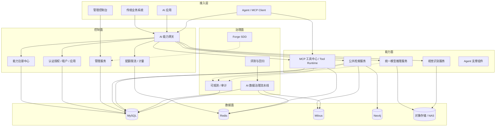
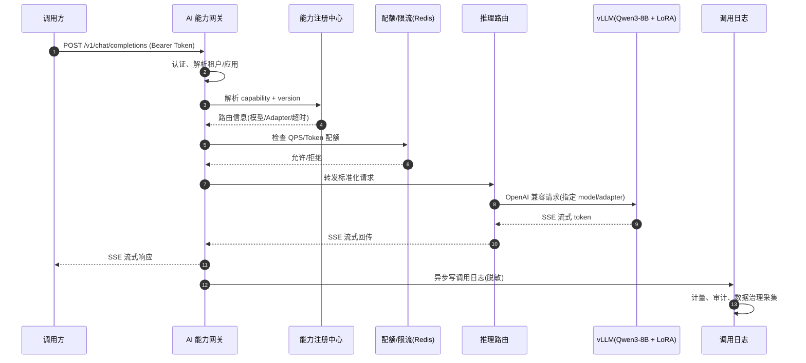
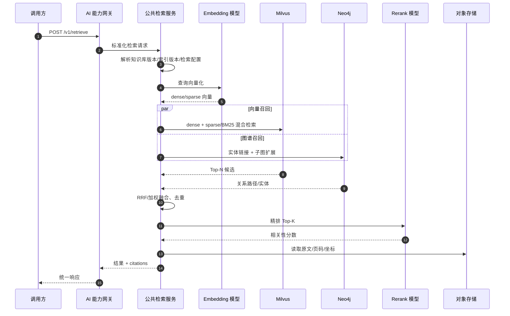
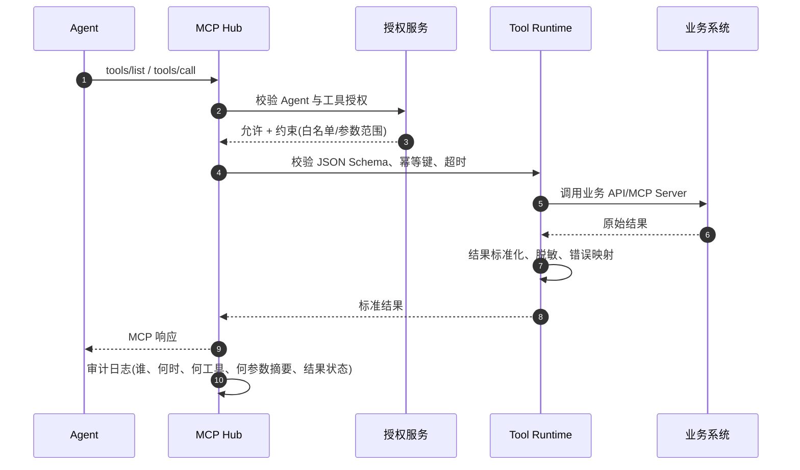
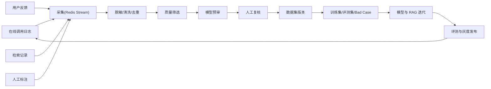
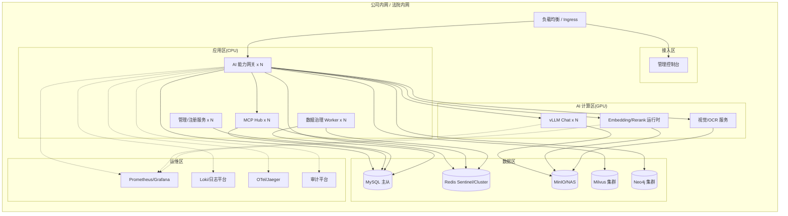

# 02 总体架构

## 1. 架构原则

1. **能力即服务（Capability as a Service）**：模型、检索、视觉、工具都以「能力」为单位注册、授权、计量和审计，而不是以具体模型或数据库为单位暴露给业务。
2. **控制面与数据面分离**：能力注册、授权、配额、版本发布属于控制面；推理、检索、工具调用属于数据面。控制面故障不应阻断已授权能力的数据面调用。
3. **统一协议、多态接入**：对外提供 OpenAI 兼容接口、平台统一调用接口、MCP 协议和 SDK；内部通过适配器屏蔽 vLLM、Milvus、Neo4j、业务系统的差异。
4. **版本化与灰度**：能力、模型、LoRA、知识库、索引、检索配置、Prompt 模板、数据集全部版本化，支持灰度、回滚和可复现评测。
5. **私有化优先**：所有组件可在法院内网离线部署；不依赖公网服务；密钥、模型权重、业务数据本地留存。
6. **默认安全与可审计**：认证、授权、脱敏、审计作为链路的一等公民，而不是后置补丁。
7. **松耦合、可替换**：推理引擎、向量库、图数据库、模型供应商通过抽象层接入，避免业务代码绑定具体实现。

## 2. 逻辑架构

### 2.1 分层说明

| 层 | 职责 | 关键约束 |
|---|---|---|
| 接入层 | 业务系统、AI 应用、Agent、控制台的统一入口 | 不直接访问模型/数据库；必须经网关或 MCP Hub |
| 控制面 | 能力注册、授权、配额、版本、配置、发布 | 高可用；配置变更需审计；支持灰度 |
| 能力面 | 推理、检索、视觉、工具调用的实际执行 | 无状态优先；可水平扩展；超时与降级可控 |
| 数据面 | 结构化数据、缓存、向量、图、原始文件 | 按租户隔离；备份可恢复；敏感字段加密 |
| 治理面 | 数据回流、评测、可观测、研发流程 | 全链路留痕；指标可追溯；不侵入在线链路 |

## 3. 核心组件清单

| 组件 | 建议技术 | 核心职责 | 扩展方式 |
|---|---|---|---|
| AI 能力网关 | Python FastAPI / Go（可选） | 认证、鉴权、路由、限流、协议转换、SSE 代理、审计 | 水平扩展，无状态 |
| 能力注册中心 | Python FastAPI + MySQL | 能力元数据、版本、生命周期、授权关系 | 控制面多副本 |
| 统一模型推理服务 | vLLM + 模型运行时适配层 | Chat、Embedding、Rerank、Vision、LoRA 管理 | GPU 副本横向扩展 |
| 公共检索服务 | Python FastAPI + Milvus + Neo4j | 文档解析、索引、混合召回、Rerank、引用溯源 | 按知识库/租户分片 |
| MCP 工具中心 | Python FastAPI + MCP SDK | 工具注册、发现、鉴权、参数校验、调用代理、幂等 | 无状态多副本 |
| 数据治理流水线 | Python Worker + Redis Streams | 采集、清洗、筛选、预审、复核、数据集版本 | 消费者组横向扩展 |
| 评测服务 | Python + 任务队列 | 模型评测、RAG 评测、回归对比、报告 | 异步任务 |
| 管理控制台 | Vue 3 + TypeScript + Element Plus | 能力、模型、知识库、数据集、配额、审计管理 | 静态资源 + API |
| 可观测性 | Prometheus + Grafana + Loki + OpenTelemetry | 指标、日志、链路、告警 | 独立运维集群 |

> 技术栈以项目介绍中的 MCP、Docker、vLLM、Milvus、Neo4j、Claude Code、MySQL、Redis 为基础。Python 作为主要开发语言，Java SDK 用于业务系统接入；对象存储可使用 MinIO 或法院既有 NAS。

## 4. 关键链路

### 4.1 模型推理链路

要点：

- 网关只做协议与治理，不承担模型推理。
- `model` 字段既可以是基座模型，也可以是 LoRA 别名；由能力注册中心映射为实际部署。
- 流式响应必须支持客户端断开取消，避免 GPU 继续生成。
- 调用日志异步落库，敏感字段脱敏，原文按安全策略决定是否留存。

### 4.2 RAG 检索链路

要点：

- 检索服务必须在响应中返回 `citations`，包括文档 ID、标题、页码、段落、片段和定位信息。
- 知识库版本、索引版本、检索配置版本三者独立，响应中回显实际使用的版本，便于复现。
- 图谱召回失败时降级为向量召回，不阻断主链路。
- Rerank 超时可降级为融合分数排序。

### 4.3 MCP 工具调用链路

要点：

- 工具必须声明输入/输出 JSON Schema、超时、重试策略、幂等语义、风险级别。
- 写操作默认要求幂等键；高风险工具需二次授权或人工确认。
- 工具返回统一为结构化结果，禁止把业务系统原始异常直接暴露给模型。
- 参数日志只记录摘要或哈希，避免敏感信息落盘。

### 4.4 数据治理链路

要点：

- 在线链路只负责产生事件，重处理全部异步化，避免影响主链路延迟。
- 数据集版本必须记录来源快照、筛选规则、统计信息和操作人。
- 人工复核结果与模型预审结果都保留，便于评估预审模型质量。

## 5. 部署架构

### 5.1 网络分区

| 区域 | 允许入站 | 允许出站 | 说明 |
|---|---|---|---|
| 接入区 | 业务网、管理网 | 应用区 | 只暴露 Ingress/负载均衡 |
| 应用区 | 接入区 | AI 区、数据区、运维区 | 禁止直接访问互联网 |
| AI 计算区 | 应用区 | 数据区（对象存储）、运维区 | GPU 节点不打业务流量 |
| 数据区 | 应用区、AI 区、治理 Worker | 无 | 仅允许白名单端口 |
| 运维区 | 应用区、AI 区、数据区 | 管理终端 | 审计与监控 |

### 5.2 高可用策略

| 组件 | 高可用方式 | RTO/RPO 建议 |
|---|---|---|
| 网关/管理服务 | 多副本 + 无状态 + 滚动发布 | RTO ≤ 5 分钟，RPO = 0 |
| vLLM 推理 | 多副本 + 能力级 fallback | RTO ≤ 10 分钟（模型加载时间） |
| MySQL | 主从/组复制 + 定期备份 | RTO ≤ 30 分钟，RPO ≤ 5 分钟 |
| Redis | Sentinel 或 Cluster + AOF | RTO ≤ 5 分钟，RPO ≤ 1 分钟 |
| Milvus | 集群模式 + 对象存储持久化 | RTO ≤ 30 分钟 |
| Neo4j | 因果集群 + 定期 dump | RTO ≤ 60 分钟 |
| 对象存储 | 多副本/纠删码 + 版本化 | RTO ≤ 30 分钟 |

## 6. 技术选型与理由

| 领域 | 选型 | 理由 | 备选 |
|---|---|---|---|
| 模型推理 | vLLM | 高吞吐、连续批处理、PagedAttention、多 LoRA 支持 | TensorRT-LLM、SGLang |
| 基座模型 | Qwen3-8B | 中文与法律文本表现好，8B 规模适合私有化 | 其他合规开源模型 |
| 微调 | LoRA / QLoRA | 多任务共享基座，训练与切换成本低 | 全量微调 |
| 向量库 | Milvus | 支持稠密/稀疏向量、混合检索、水平扩展 | pgvector、Qdrant |
| 图数据库 | Neo4j | 成熟的关系查询与图算法，适合 GraphRAG | NebulaGraph |
| 关系库 | MySQL | 团队熟悉、生态成熟、运维成本低 | PostgreSQL |
| 缓存/队列 | Redis | 低延迟；Streams 可满足 v1 异步流水线 | Kafka、RabbitMQ |
| 容器 | Docker + Kubernetes | 私有化交付标准；GPU 调度成熟 | Docker Swarm |
| 可观测 | Prometheus + Grafana + Loki + OTel | 开源、可离线、生态完整 | 商业 APM |
| 研发流程 | Claude Code + Forge SDD | 与现有 AI Coding 实践一致，可沉淀 Skills | 其他编码 Agent |

## 7. 非功能设计

### 7.1 性能基线（设计目标）

| 指标 | 目标 | 说明 |
|---|---|---|
| 网关附加延迟 | P95 ≤ 30 ms | 不含模型推理与检索耗时 |
| Chat 首 Token 延迟 | P95 ≤ 2 s | 1K 输入、基座模型、基线 GPU |
| Chat 吞吐 | 集群 ≥ 15 req/s（2 副本） | Qwen3-8B，单基座 + 双 LoRA 混合负载，压测校准 |
| 检索延迟 | P95 ≤ 500 ms | Top-50 混合召回 + Rerank，单知识库 |
| 工具调用开销 | P95 ≤ 20 ms | 不含业务系统耗时 |
| 日志落库延迟 | P95 ≤ 5 s | 异步链路 |
| 管理 API | P95 ≤ 200 ms | 常规分页查询 |

### 7.2 可用性

- 在线服务目标 99.5%，控制面目标 99.9%。
- 关键依赖（Redis、MySQL、Milvus）故障时，按能力等级降级：检索失败可降级为纯模型回答；限流组件故障时使用本地令牌桶兜底。
- 模型副本故障时，网关按健康检查摘除并重试其他副本；重试仅限幂等请求。

### 7.3 扩展性

- 网关、检索、MCP Hub 无状态水平扩展。
- 推理服务按 GPU 副本扩展；LoRA 通过注册中心动态加载。
- Milvus 按知识库/租户分区；Neo4j 可按业务域拆库。
- 数据治理 Worker 使用 Redis Streams 消费者组扩展。

### 7.4 安全与合规

- 统一身份认证 + 租户/应用授权 + 能力级授权。
- 传输 TLS，敏感字段落库加密，密钥由 KMS/Secret 管理。
- 审计日志不可篡改，保留期限按合规要求配置。
- Prompt 注入防护、输出内容过滤、工具白名单与参数约束。
- 数据分级分类、脱敏、最小化留存、可删除。

### 7.5 可观测性

- **指标**：请求量、错误率、P50/P95/P99 延迟、TTFT、Token 用量、GPU 利用率、显存、队列长度、检索召回耗时、Rerank 耗时、工具成功率。
- **日志**：结构化 JSON，包含 `request_id`、`trace_id`、`tenant_id`、`app_id`、`capability`、`status`、`latency`；敏感字段脱敏。
- **链路**：OpenTelemetry 贯穿网关、推理、检索、工具；采样率可配置。
- **审计**：能力发布、授权变更、配额变更、数据导出、工具写操作等必须审计。

## 8. 关键设计决策（ADR）

### ADR-001：能力注册表而非硬编码路由

**决策**：所有对外能力先在注册中心登记，网关按能力编码和版本路由。  
**理由**：业务不直接依赖模型名/数据库地址；支持灰度、回滚、授权和计量。  
**代价**：增加一次控制面查询，需要本地缓存与失效机制。

### ADR-002：单基座 + 多 LoRA

**决策**：Qwen3-8B 作为共享基座，分类、抽取等任务以 LoRA Adapter 形式加载。  
**理由**：避免每个任务独立部署一份基座权重，降低显存与加载时间；便于统一升级基座。  
**代价**：存在 LoRA 间干扰和显存上限，需要限制并发 Adapter 数量并做效果评测。

### ADR-003：Milvus + Neo4j 双引擎

**决策**：向量/关键词召回走 Milvus，实体关系与多跳推理走 Neo4j。  
**理由**：司法场景既有语义相似需求，也有法条、当事人、案由之间的关系推理需求。  
**代价**：两套索引的一致性、版本管理和运维复杂度上升。

### ADR-004：知识库、索引、检索配置三版本分离

**决策**：三者独立版本化，检索时显式绑定。  
**理由**：文档更新、索引重建、参数调优的节奏不同；分离后可以独立灰度与回滚。  
**代价**：需要维护版本兼容矩阵和别名机制。

### ADR-005：OpenAI 兼容 + 平台扩展接口

**决策**：Chat/Embedding 提供 OpenAI 兼容接口；检索、工具、治理使用平台原生接口。  
**理由**：存量应用迁移成本低；平台特有能力不受 OpenAI 协议限制。  
**代价**：需要维护两套契约与错误码映射。

### ADR-006：MCP 作为工具接入标准

**决策**：Agent 侧工具统一通过 MCP 暴露；中台提供 MCP Hub 做治理。  
**理由**：与 Agent 生态兼容，工具可发现、可复用；治理逻辑集中。  
**代价**：需要处理 MCP 版本兼容、会话管理和长连接。

### ADR-007：异步数据闭环

**决策**：在线链路只发事件，数据治理全部异步。  
**理由**：避免数据清洗、模型预审影响在线延迟；便于重放和补偿。  
**代价**：需要保证事件不丢、幂等消费和延迟监控。

## 9. 与 Agent Harness 的关系

Agent Harness 关注 Agent 运行时的 Guardrails、Tool Runtime、Trace 与评测；司法 AI 中台关注能力供给与数据治理。两者边界建议如下：

| 能力 | 中台 | Agent Harness |
|---|---|---|
| 模型推理 | 提供统一模型能力 | 消费模型能力，负责 Agent 决策 |
| RAG/GraphRAG | 提供检索与引用 | 决定何时检索、如何组装上下文 |
| MCP 工具 | 提供工具注册、鉴权、统一调用 | 决定工具选择与调用顺序 |
| Guardrails | 提供输出过滤、敏感信息检测等基础能力 | 负责动作白名单、步数限制、业务边界约束 |
| Trace | 提供调用级日志与指标 | 提供 Agent 级执行轨迹与状态变化 |
| 评测 | 提供模型/RAG 评测集与指标 | 提供 Agent 任务级评测 |

建议通过统一的 `trace_id` 和 `request_id` 串联两侧链路，避免重复建设。
