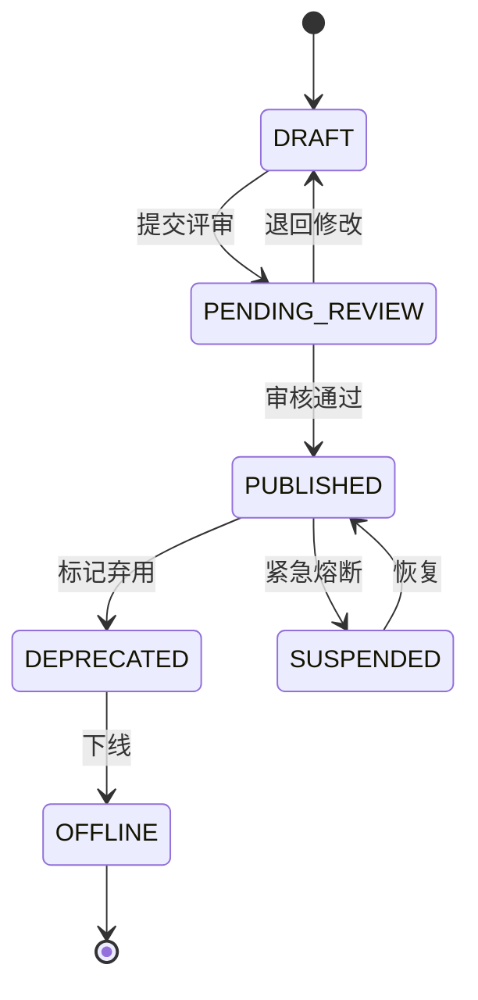

# 03 AI 能力注册与服务网关

## 1. 设计目标

1. 把模型推理、RAG、视觉识别、MCP 工具统一抽象为「能力」，业务方按能力编码调用，不直接依赖模型名、数据库地址或工具实现。
2. 通过统一网关完成认证、鉴权、限流、配额、路由、灰度、协议转换、超时重试、审计和计量。
3. 能力版本不可变，支持发布、灰度、回滚和下线；已发布版本的行为可复现。
4. 同时兼容 OpenAI 接口和平台原生接口，降低存量系统迁移成本。

## 2. 能力模型

### 2.1 能力类型

| 类型 | 编码 | 说明 | 典型协议 |
|---|---|---|---|
| 对话模型 | `MODEL_CHAT` | 通用/领域对话、文书生成、摘要 | OpenAI Chat Completions |
| 向量模型 | `MODEL_EMBEDDING` | 文本向量化 | OpenAI Embeddings |
| 重排模型 | `MODEL_RERANK` | 候选片段精排 | 平台 Rerank |
| 视觉模型 | `MODEL_VISION` | OCR、版面分析、图像分类、VLM | 平台 Vision |
| 检索能力 | `RAG_RETRIEVE` | 混合召回 + 重排 + 引用 | 平台 Retrieve |
| 图谱能力 | `GRAPH_RETRIEVE` | 实体链接、子图检索、关系推理 | 平台 Graph |
| MCP 工具 | `MCP_TOOL` | 业务系统工具、查询、写操作 | MCP |
| 复合能力 | `COMPOSITE` | 检索 + 生成、OCR + 抽取等编排 | 平台 Invoke |

> v1 优先实现 `MODEL_CHAT`、`MODEL_EMBEDDING`、`MODEL_RERANK`、`MODEL_VISION`、`RAG_RETRIEVE`、`MCP_TOOL`。`COMPOSITE` 可通过工作流配置逐步开放。

### 2.2 能力元数据

| 字段 | 类型 | 必填 | 说明 |
|---|---|---|---|
| `code` | string | 是 | 全局唯一能力编码，如 `llm.qwen3.chat` |
| `name` | string | 是 | 展示名称 |
| `type` | enum | 是 | 能力类型 |
| `description` | text | 否 | 能力说明与适用场景 |
| `owner` | string | 是 | 责任团队/负责人 |
| `scope` | enum | 是 | `GLOBAL` / `TENANT` |
| `tenant_id` | bigint | 条件 | `TENANT` 范围时必填 |
| `version` | semver | 是 | 能力版本 |
| `status` | enum | 是 | 生命周期状态 |
| `protocol` | enum | 是 | `OPENAI` / `PLATFORM` / `MCP` |
| `endpoint` | string | 是 | 上游地址（内部） |
| `model_name` | string | 条件 | 基座模型名称，如 `Qwen3-8B` |
| `adapter_alias` | string | 条件 | LoRA 别名；与 `model_name` 组合使用 |
| `request_schema` | JSON | 是 | 入参 JSON Schema |
| `response_schema` | JSON | 是 | 出参 JSON Schema |
| `default_timeout_ms` | int | 是 | 默认超时 |
| `max_timeout_ms` | int | 是 | 调用方可设置的最大超时 |
| `max_input_tokens` | int | 否 | 最大输入 Token |
| `max_output_tokens` | int | 否 | 最大输出 Token |
| `qps_limit` | int | 否 | 默认 QPS 上限 |
| `concurrency_limit` | int | 否 | 并发上限 |
| `retry_policy` | JSON | 否 | 重试次数、退避策略 |
| `health_check` | JSON | 否 | 健康检查路径与周期 |
| `security_level` | enum | 否 | 数据敏感级别 |
| `tags` | string[] | 否 | 检索标签 |
| `metadata` | JSON | 否 | 扩展字段 |

### 2.3 能力版本与状态机



规则：

1. `PUBLISHED` 版本的元数据与配置不可修改；任何变更必须创建新版本。
2. 每个能力在 `prod` 通道只能有一个默认版本；灰度版本可以多个。
3. `DEPRECATED` 版本仍可调用，但响应头返回 `X-Capability-Deprecated: true`，并记录告警。
4. `OFFLINE` 版本拒绝新请求，保留历史调用记录。
5. `SUSPENDED` 用于安全事件或严重故障，网关立即停止路由。

### 2.4 能力注册接口

```http
POST /api/v1/admin/capabilities
Content-Type: application/json
Authorization: Bearer <admin-token>
```

```json
{
  "code": "llm.qwen3.chat",
  "name": "司法通用对话模型",
  "type": "MODEL_CHAT",
  "description": "基于 Qwen3-8B 的通用司法对话能力",
  "owner": "ai-platform",
  "scope": "GLOBAL",
  "version": "1.0.0",
  "protocol": "OPENAI",
  "endpoint": "http://vllm-chat:8000/v1",
  "model_name": "Qwen3-8B",
  "request_schema": {
    "type": "object",
    "required": ["messages"],
    "properties": {
      "messages": {"type": "array"},
      "temperature": {"type": "number", "minimum": 0, "maximum": 2},
      "max_tokens": {"type": "integer", "minimum": 1}
    }
  },
  "response_schema": {"type": "object"},
  "default_timeout_ms": 60000,
  "max_timeout_ms": 120000,
  "max_input_tokens": 32768,
  "max_output_tokens": 8192,
  "qps_limit": 20,
  "concurrency_limit": 16,
  "security_level": "INTERNAL",
  "tags": ["chat", "judicial", "qwen3"]
}
```

注册校验：

- `code` 匹配 `^[a-z][a-z0-9_.-]{2,127}$`，且全局唯一。
- `version` 必须为合法 SemVer。
- `request_schema` / `response_schema` 必须是合法 JSON Schema。
- `endpoint` 必须通过健康检查（可配置为异步校验）。
- `model_name` / `adapter_alias` 必须存在于模型部署注册表。
- 安全级别、数据驻留、模型备案信息必须完整。

### 2.5 能力发布与授权

```http
POST /api/v1/admin/capabilities/{code}/versions/{version}/publish
POST /api/v1/admin/capabilities/{code}/versions/{version}/rollback
POST /api/v1/admin/capabilities/{code}/grants
```

授权维度：

| 维度 | 说明 |
|---|---|
| 租户 | 哪些租户可使用该能力 |
| 应用 | 哪些应用可使用该能力 |
| 环境 | `dev` / `test` / `staging` / `prod` |
| 配额 | QPS、并发、日/月 Token 或调用量 |
| 数据范围 | 可访问的知识库、工具、案件范围 |
| 有效期 | 临时授权到期自动失效 |

授权变更必须审计，并在 Redis 中发布失效事件，网关本地缓存最多 10 秒内生效。

## 3. 统一网关

### 3.1 网关职责边界

网关**必须**做：

- 认证、租户/应用解析、能力授权。
- 配额与限流。
- 能力版本解析与路由。
- 请求/响应结构校验。
- 协议转换与 SSE 代理。
- 超时、重试、熔断、降级。
- 调用日志、计量、审计。
- 请求 ID / Trace ID 注入。

网关**不应**做：

- 模型推理、Prompt 组装、RAG 编排。
- 业务规则判断。
- 长时间异步任务执行（应转任务队列）。
- 原始文件解析。

### 3.2 请求处理流水线


### 3.3 认证方式

| 方式 | 适用场景 | 说明 |
|---|---|---|
| API Key | 服务端到服务端 | `Authorization: Bearer ak_xxx`；仅存哈希；支持轮换与禁用 |
| OAuth2 Client Credentials | 企业级应用 | 获取短期 access token；推荐生产使用 |
| OIDC / SSO | 管理控制台 | 对接统一身份认证 |
| mTLS | 高安全租户 | 双向证书校验，可与 API Key 叠加 |
| 内部服务签名 | 服务间调用 | 短期签名 + 时间戳 + nonce，防重放 |

安全要求：

- API Key 必须可轮换，支持双 Key 并存过渡。
- Token 有效期建议 ≤ 2 小时。
- 认证失败不得泄露具体校验细节。
- 所有认证事件写入审计日志。

### 3.4 限流与配额

#### 3.4.1 限流维度

- 租户级：防止单一租户挤占平台。
- 应用级：应用配额。
- 能力级：保护特定模型或工具。
- 模型部署级：保护 GPU 副本。
- 用户级（可选）：防止单个用户滥用。

#### 3.4.2 限流算法

采用 Redis + Lua 实现滑动窗口计数，配合令牌桶处理突发：

```lua
-- KEYS[1] = rate_limit:{dimension}:{window}
-- ARGV[1] = now_ms
-- ARGV[2] = window_ms
-- ARGV[3] = limit
-- ARGV[4] = member
local now = tonumber(ARGV[1])
local window = tonumber(ARGV[2])
local limit = tonumber(ARGV[3])
local member = ARGV[4]

redis.call('ZREMRANGEBYSCORE', KEYS[1], 0, now - window)
local count = redis.call('ZCARD', KEYS[1])
if count >= limit then
  return 0
end
redis.call('ZADD', KEYS[1], now, member)
redis.call('PEXPIRE', KEYS[1], window)
return 1
```

配额类型：

| 配额 | 说明 | 超限行为 |
|---|---|---|
| QPS | 每秒请求数 | 429 + `Retry-After` |
| 并发 | 同时处理请求数 | 429 或排队（可配置） |
| 日/月调用量 | 请求总数 | 403 `QUOTA_EXCEEDED` |
| 日/月 Token | 输入+输出 Token | 403 `QUOTA_EXCEEDED` |
| 存储量 | 知识库/数据集容量 | 拒绝写入 |

降级策略：

- Redis 不可用时，使用进程内令牌桶兜底，并记录告警。
- 限流阈值支持按时间计划动态调整（如工作时间/夜间）。
- 重要租户可配置预留配额，避免被其他租户挤占。

### 3.5 路由与灰度

路由决策输入：

1. 能力编码与版本。
2. 租户/应用白名单。
3. 灰度权重。
4. 上游健康状态。
5. GPU 池/区域。
6. 请求特性（流式/非流式、上下文长度）。

路由策略：

| 策略 | 说明 |
|---|---|
| 版本路由 | 指定版本调用；未指定时使用 `prod` 默认版本 |
| 权重灰度 | 按百分比将流量分配到新版本 |
| 租户白名单 | 指定租户优先体验新版本 |
| 主备降级 | 主模型不可用时切换备用模型/能力 |
| 区域路由 | 按部署区域或法院内网节点路由 |
| 长度路由 | 超长上下文路由到支持更长上下文的部署 |

降级链示例：

```yaml
fallback:
  - capability: llm.qwen3.chat
    version: 1.0.0
  - capability: llm.qwen3.chat
    version: 0.9.0
  - capability: llm.generic.chat
    version: 1.0.0
    degraded: true
```

规则：

- 降级仅对可重试错误生效（超时、5xx、上游不可用）。
- 降级后响应头返回 `X-Degraded: true` 与实际能力版本。
- 降级事件必须计入指标与告警。
- 流式请求一旦向客户端发送数据，不得切换上游重试。

### 3.6 超时、重试与熔断

| 参数 | 默认值 | 说明 |
|---|---|---|
| 网关总超时 | 上游超时 + 2s | 包含排队、连接、读取 |
| 连接超时 | 1s | 上游连接建立 |
| 读超时 | 按能力配置 | 流式请求按空闲超时计算 |
| 最大重试次数 | 2 | 仅幂等请求 |
| 退避 | 指数退避 + 抖动 | 100ms、300ms、900ms |
| 熔断失败率 | 50% | 30s 窗口，最少 20 次请求 |
| 熔断打开时长 | 30s | 半开状态放行 5 个探测请求 |

禁止重试的场景：

- 非幂等工具写操作（除非携带幂等键且上游支持）。
- 已经向客户端发送流式数据。
- 上游返回 4xx（429 除外，需遵循 `Retry-After`）。

### 3.7 请求与响应规范

#### 3.7.1 平台统一调用接口

```http
POST /api/v1/capabilities/{code}/invoke
Authorization: Bearer <token>
Content-Type: application/json
X-Request-Id: optional
Idempotency-Key: optional
```

```json
{
  "version": "1.0.0",
  "input": {
    "messages": [
      {"role": "system", "content": "你是司法辅助助手。"},
      {"role": "user", "content": "请概括本案争议焦点。"}
    ]
  },
  "options": {
    "stream": false,
    "timeout_ms": 30000,
    "temperature": 0.2
  },
  "trace_id": "trace-xxx"
}
```

```json
{
  "request_id": "req-20261019-0001",
  "capability": "llm.qwen3.chat",
  "version": "1.0.0",
  "output": {
    "choices": [
      {"index": 0, "message": {"role": "assistant", "content": "本案争议焦点为……"}}
    ]
  },
  "usage": {
    "input_tokens": 128,
    "output_tokens": 256,
    "total_tokens": 384
  },
  "latency_ms": 1832,
  "degraded": false
}
```

#### 3.7.2 OpenAI 兼容接口

| 接口 | 说明 |
|---|---|
| `POST /v1/chat/completions` | 对话，支持 `stream=true` |
| `POST /v1/embeddings` | 文本向量化 |
| `POST /v1/rerank` | 重排（平台扩展，命名兼容常见 Rerank API） |

`model` 字段支持三种写法：

1. 能力编码：`llm.qwen3.chat`（推荐）。
2. 能力编码 + 版本：`llm.qwen3.chat@1.0.0`。
3. LoRA 别名：`judicial-case-classify`（需在注册中心绑定能力）。

#### 3.7.3 SSE 流式规范

```
HTTP/1.1 200 OK
Content-Type: text/event-stream; charset=utf-8
Cache-Control: no-cache
X-Accel-Buffering: no

data: {"id":"req-1","choices":[{"delta":{"content":"本"}}]}

data: {"id":"req-1","choices":[{"delta":{"content":"案"}}]}

data: [DONE]
```

要求：

- Ingress/Nginx 必须关闭缓冲，避免流式被聚合。
- 每 15 秒发送注释心跳 `: keep-alive`。
- 客户端断开后，网关必须取消上游请求。
- 流式请求的 Token 计量在流结束后统一结算；异常中断按已生成内容估算并标记。
- 错误发生在流开始前，返回标准 JSON 错误；流开始后，通过 `event: error` 发送。

### 3.8 幂等设计

- 写操作工具、复合能力支持 `Idempotency-Key`。
- Redis 键：`idem:{app_id}:{key}`，TTL 24 小时。
- 存储内容：请求体哈希、状态、响应快照。
- 同一 Key、不同请求体 → `409 IDEMPOTENCY_CONFLICT`。
- 处理中重复请求 → 返回 `409 IDEMPOTENCY_IN_PROGRESS` 或等待结果（可配置）。
- 幂等只保证「同一应用内」唯一。

### 3.9 错误模型

```json
{
  "error": {
    "code": "RATE_LIMITED",
    "message": "请求过于频繁，请稍后重试",
    "type": "client_error",
    "request_id": "req-20261019-0001",
    "details": {
      "retry_after_ms": 1000
    }
  }
}
```

| 错误码 | HTTP | 说明 |
|---|---|---|
| `AUTH_INVALID` | 401 | 凭证无效 |
| `TOKEN_EXPIRED` | 401 | Token 过期 |
| `FORBIDDEN` | 403 | 无能力授权 |
| `QUOTA_EXCEEDED` | 403 | 配额耗尽 |
| `CAPABILITY_NOT_FOUND` | 404 | 能力不存在 |
| `VERSION_NOT_FOUND` | 404 | 版本不存在 |
| `CAPABILITY_OFFLINE` | 410 | 能力已下线 |
| `INVALID_ARGUMENT` | 400 | 参数校验失败 |
| `CONTEXT_LENGTH_EXCEEDED` | 400 | 上下文超限 |
| `IDEMPOTENCY_CONFLICT` | 409 | 幂等键冲突 |
| `IDEMPOTENCY_IN_PROGRESS` | 409 | 幂等请求处理中 |
| `RATE_LIMITED` | 429 | 触发限流 |
| `UPSTREAM_TIMEOUT` | 504 | 上游超时 |
| `UPSTREAM_UNAVAILABLE` | 503 | 上游不可用 |
| `CONTENT_FILTERED` | 422 | 内容安全检查未通过 |
| `INTERNAL_ERROR` | 500 | 平台内部错误 |

错误响应不得包含堆栈、上游地址、SQL、密钥等敏感信息。

## 4. 能力发现

```http
GET /api/v1/capabilities?type=MODEL_CHAT&tag=judicial&status=PUBLISHED
```

返回仅包含当前应用已授权的能力：

```json
{
  "items": [
    {
      "code": "llm.qwen3.chat",
      "name": "司法通用对话模型",
      "type": "MODEL_CHAT",
      "default_version": "1.0.0",
      "versions": ["1.0.0", "1.1.0-rc.1"],
      "protocol": "OPENAI",
      "tags": ["chat", "judicial"],
      "schema_url": "/api/v1/capabilities/llm.qwen3.chat/schema"
    }
  ],
  "total": 1
}
```

要求：

- 发现接口必须支持按类型、标签、状态、租户过滤。
- 返回的能力描述应足以生成客户端代码或 MCP 工具描述。
- 不泄露未授权能力的存在性（可选：返回 404 而非 403）。

## 5. 缓存与配置

| 缓存 | 键 | TTL | 失效方式 |
|---|---|---|---|
| 能力元数据 | `cap:{code}:{version}` | 60s | Redis Pub/Sub |
| 授权关系 | `grant:{app_id}:{code}` | 30s | Redis Pub/Sub |
| 路由表 | `route:{code}:{env}` | 30s | 发布事件 |
| 限流计数 | `rl:{dimension}:{window}` | 窗口长度 | 自动过期 |
| 幂等记录 | `idem:{app_id}:{key}` | 24h | 自动过期 |

本地缓存建议使用 LRU（最多 10k 条），并设置 10 秒软过期，避免控制面故障导致完全不可用。

## 6. 可观测性

### 6.1 指标

```text
gateway_requests_total{tenant,app,capability,version,status}
gateway_request_duration_ms{capability,version,quantile}
gateway_upstream_duration_ms{capability,upstream,quantile}
gateway_tokens_total{tenant,app,capability,direction}
gateway_rate_limited_total{tenant,app,dimension}
gateway_circuit_breaker_state{upstream}
gateway_sse_active_connections{capability}
```

### 6.2 日志字段

| 字段 | 说明 |
|---|---|
| `request_id` | 请求唯一 ID |
| `trace_id` | 链路 ID |
| `tenant_id` / `app_id` | 租户与应用 |
| `capability` / `version` | 能力与版本 |
| `status` / `error_code` | 结果 |
| `latency_ms` / `upstream_latency_ms` | 延迟 |
| `input_tokens` / `output_tokens` | Token 用量 |
| `client_ip` / `user_agent` | 客户端信息（按合规要求脱敏） |

### 6.3 审计事件

- 能力注册、发布、回滚、下线。
- 授权新增、撤销、变更。
- 配额调整。
- API Key 创建、轮换、禁用。
- 高风险工具调用。
- 数据导出、批量删除。

审计日志必须包含操作人、时间、对象、变更前后值、来源 IP、结果，且不可被普通管理员删除。

## 7. 验收标准

1. 能力可完成注册、评审、发布、灰度、回滚、下线全流程。
2. 未授权应用调用返回 403；授权撤销后 10 秒内生效。
3. QPS/Token 配额准确，超限返回 429/403，且不影响其他租户。
4. 灰度权重生效，响应头回显实际版本；回滚后新请求立即切换到旧版本。
5. SSE 流式响应可正常透传，客户端断开后上游请求被取消。
6. 上游超时、5xx 时按配置重试与降级；非幂等请求不重复执行。
7. 所有调用生成 `request_id`、计量记录和审计事件。
8. 网关附加延迟 P95 ≤ 30ms（1k QPS 压测，不含上游）。
9. 控制面不可用时，已缓存能力仍可继续服务（只读降级）。
