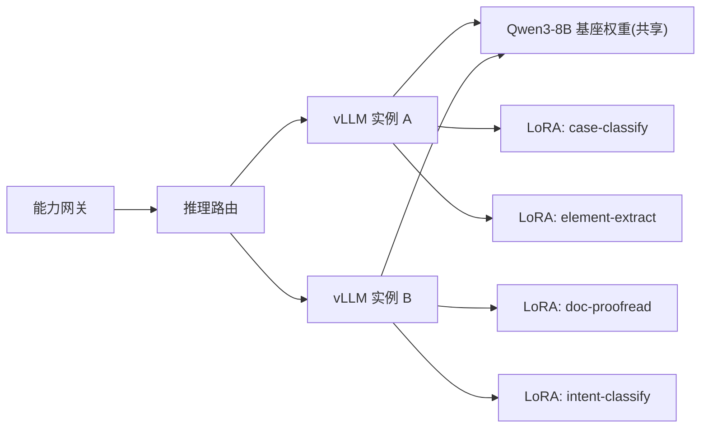
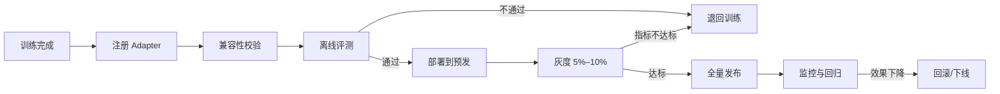

# 04 统一模型推理服务

## 1. 设计目标

1. 以 vLLM 为核心，提供统一的 Chat、Embedding、Rerank、Vision 推理能力，对外屏蔽模型与硬件差异。
2. 采用「单基座 + 多 LoRA Adapter」承载多类司法任务，减少多模型独立部署的显存占用和加载开销。
3. 支持模型/Adapter 的注册、评测、灰度、热加载、回滚和下线。
4. 在中等并发下保证首 Token 延迟和吞吐，支持法院内网私有化交付。
5. 提供完整的指标、日志和故障处理手段。

## 2. 模型矩阵

### 2.1 v1 模型清单

| 能力 | 模型 | 规模 | 部署方式 | 说明 |
|---|---|---|---|---|
| 通用对话/生成 | Qwen3-8B | 8B | vLLM，BF16 | 共享基座 |
| 案由分类 | Qwen3-8B + LoRA | 8B + Adapter | vLLM 多 LoRA | 分类/意图识别 |
| 要素抽取 | Qwen3-8B + LoRA | 8B + Adapter | vLLM 多 LoRA | 结构化抽取 |
| 文书校对 | Qwen3-8B + LoRA | 8B + Adapter | vLLM 多 LoRA | 格式/术语一致性 |
| 文本向量 | BGE-M3 | 0.6B | Embedding 运行时 | dense 1024 维；可选 sparse |
| 重排 | BGE-Reranker-v2-M3 | 0.6B | Rerank 运行时 | 候选精排 |
| OCR/版面 | PaddleOCR + 版面分析 | - | CPU/GPU | 扫描件与表格 |
| 视觉理解 | Qwen3-VL-7B（或经评测的 Qwen2.5-VL-7B） | 7B | vLLM | 图片/文档问答、要素识别 |

> 模型清单是 v1 建议基线。所有模型上线前必须完成合规评审、效果评测和安全评估；LoRA 与基座版本必须锁定兼容关系。

### 2.2 模型与能力的关系

- 一个模型部署可以承载多个能力版本。
- 一个能力版本只绑定一个模型部署和一个 Adapter 别名。
- 业务调用使用能力编码，不直接使用模型名称。
- 模型升级通过新增部署 + 灰度切换完成，不修改已发布能力版本。

## 3. 单基座 + 多 LoRA 架构

### 3.1 架构



### 3.2 设计要点

1. **基座共享**：所有 Adapter 复用同一份 Qwen3-8B 权重，显存中只保留一份基座。
2. **Adapter 按需驻留**：vLLM 的 `max_loras` 控制 GPU 上同时驻留的 Adapter 数量，`max_cpu_loras` 控制 CPU 侧缓存。
3. **严格路由**：请求必须显式指定 Adapter 别名；禁止「自动猜测」Adapter，避免任务串扰。
4. **隔离评估**：每个 Adapter 必须在独立评测集上验证，并评估对其他任务的干扰。
5. **数量控制**：建议单实例同时驻留 2–4 个 Adapter；超过后通过动态加载/卸载切换，避免批处理效率下降。
6. **版本绑定**：Adapter 必须记录基座模型版本、训练数据版本、训练参数和评测报告。

### 3.3 Adapter 注册信息

| 字段 | 说明 |
|---|---|
| `adapter_id` | 唯一 ID |
| `alias` | 请求中使用的模型别名，如 `judicial-case-classify` |
| `base_model` | 基座模型及版本 |
| `path` | 权重路径（对象存储/NAS） |
| `rank` | LoRA rank |
| `target_modules` | 目标模块 |
| `training_dataset_version` | 训练集版本 |
| `eval_report_id` | 评测报告 |
| `status` | `REGISTERED` / `LOADING` / `ACTIVE` / `INACTIVE` / `FAILED` |
| `checksum` | 权重校验和 |
| `owner` | 负责人 |

## 4. vLLM 部署

### 4.1 启动参数基线

```bash
vllm serve /models/Qwen3-8B \
  --served-model-name Qwen3-8B \
  --host 0.0.0.0 \
  --port 8000 \
  --tensor-parallel-size 1 \
  --dtype bfloat16 \
  --max-model-len 32768 \
  --gpu-memory-utilization 0.90 \
  --max-num-seqs 64 \
  --max-num-batched-tokens 8192 \
  --enable-prefix-caching \
  --enable-chunked-prefill \
  --enable-lora \
  --max-loras 4 \
  --max-lora-rank 64 \
  --max-cpu-loras 16 \
  --lora-modules judicial-case-classify=/models/lora/case-classify \
  --trust-remote-code
```

说明：

- `--max-model-len` 根据业务上下文设置。32K 会显著占用 KV Cache，若业务以 8K 为主，建议降到 16K 或 8K。
- `--max-num-seqs` 与 `--max-num-batched-tokens` 需联合压测调优；过大可能导致首 Token 延迟上升或 OOM。
- `--enable-prefix-caching` 对固定系统 Prompt 有效；多租户敏感场景需评估 KV 共享的隔离要求。
- Qwen3 的思考模式可通过模板参数控制；如启用 reasoning parser，应在网关层统一处理思考内容与最终答案的分离。
- 生产环境固定 vLLM、CUDA、驱动、模型权重的版本组合，并记录在部署清单中。

### 4.2 多 LoRA 参数

| 参数 | 建议 | 说明 |
|---|---|---|
| `--max-loras` | 2–4 | GPU 上同时驻留的 Adapter 数 |
| `--max-lora-rank` | 16–64 | 必须 ≥ 所有 Adapter 的最大 rank |
| `--max-cpu-loras` | 8–16 | CPU 侧缓存，便于快速换入 |
| `VLLM_ALLOW_RUNTIME_LORA_UPDATING` | `true` | 允许运行时加载/卸载（按版本确认） |
| `--lora-modules` | 预加载核心 Adapter | 冷启动即可用 |

运行时加载示例（以实际 vLLM 版本 API 为准）：

```bash
curl -X POST http://vllm-chat:8000/v1/load_lora_adapter \
  -H 'Content-Type: application/json' \
  -d '{
    "lora_name": "judicial-case-classify-v2",
    "lora_path": "/models/lora/case-classify-v2"
  }'
```

卸载：

```bash
curl -X POST http://vllm-chat:8000/v1/unload_lora_adapter \
  -H 'Content-Type: application/json' \
  -d '{"lora_name": "judicial-case-classify-v2"}'
```

要求：

- 加载前校验 Adapter 与基座版本、rank、目标模块是否兼容。
- 加载操作串行化，避免并发加载导致显存峰值。
- 加载失败不得影响已驻留 Adapter；失败信息写入审计和告警。
- 卸载前先摘除路由流量，等待在途请求完成（优雅退出时间 ≥ 2 分钟）。

### 4.3 Kubernetes 部署要点

```yaml
apiVersion: apps/v1
kind: Deployment
metadata:
  name: vllm-qwen3-8b
spec:
  replicas: 2
  strategy:
    rollingUpdate:
      maxUnavailable: 0
      maxSurge: 1
  template:
    spec:
      nodeSelector:
        accelerator: nvidia-a100-80g
      containers:
        - name: vllm
          image: vllm/vllm-openai:<pinned-version>
          args:
            - "--model=/models/Qwen3-8B"
            - "--served-model-name=Qwen3-8B"
            - "--max-model-len=32768"
            - "--gpu-memory-utilization=0.90"
            - "--max-num-seqs=64"
            - "--enable-lora"
            - "--max-loras=4"
            - "--max-lora-rank=64"
          ports:
            - containerPort: 8000
          readinessProbe:
            httpGet:
              path: /health
              port: 8000
            initialDelaySeconds: 30
            periodSeconds: 10
            failureThreshold: 6
          startupProbe:
            httpGet:
              path: /health
              port: 8000
            initialDelaySeconds: 60
            periodSeconds: 10
            failureThreshold: 60
          resources:
            limits:
              nvidia.com/gpu: 1
          volumeMounts:
            - name: models
              mountPath: /models
              readOnly: true
      volumes:
        - name: models
          persistentVolumeClaim:
            claimName: model-weights
```

要求：

- 模型权重放在 PVC/NAS/对象存储缓存，避免每次启动重复下载。
- `startupProbe` 需覆盖模型加载时间（8B 模型通常 1–5 分钟，视存储而定）。
- 滚动发布时 `maxUnavailable: 0`，先启动新副本并通过健康检查，再摘除旧副本。
- 配置 PodDisruptionBudget，避免节点维护导致全部副本同时下线。
- GPU 节点打 taint，业务 Pod 不调度到 GPU 节点。

### 4.4 Embedding / Rerank 部署

- BGE-M3 与 BGE-Reranker-v2-M3 可使用 vLLM pooling 能力承载；若版本不兼容，使用独立轻量运行时（如 Infinity/TEI/FlagEmbedding 服务）。
- 对外统一由「模型推理服务」封装，业务仍通过能力编码调用。
- Embedding 批大小建议 32–128，按显存和延迟调优；Rerank 批大小建议 16–64。
- 向量维度、归一化方式、最大长度必须写入能力元数据，避免不同索引混用。

### 4.5 视觉服务部署

- OCR 与版面分析可使用 CPU 或独立 GPU，避免与 LLM 争抢显存。
- PDF 先按页渲染为图片（建议 200–300 DPI），再进入 OCR/版面分析。
- VLM 建议独立部署，避免与 Qwen3-8B 混部导致显存不足。
- 输出统一为结构化 `pages`、`blocks`、`tables`、`figures`，并保留页码和坐标，供引用溯源。

## 5. LoRA 生命周期



### 5.1 注册与校验

必须校验：

1. 基座模型版本完全匹配。
2. LoRA rank ≤ `max_lora_rank`。
3. 目标模块与基座架构兼容。
4. 权重文件完整、校验和一致。
5. 训练数据版本、评测报告、合规审批齐全。

### 5.2 评测门槛（建议）

| 指标 | 门槛 |
|---|---|
| 目标任务准确率/F1 | 不低于基线，且较上一版本提升 ≥ 1 个百分点或达到业务目标 |
| 其他任务干扰 | 关键任务指标下降 ≤ 1 个百分点 |
| 幻觉/编造率 | 不高于基线 |
| 安全与合规 | 无高危问题 |
| 延迟 | P95 不超过基线的 110% |

### 5.3 灰度与回滚

- 灰度按租户白名单或流量权重进行。
- 灰度期间对比：任务指标、人工抽检、用户反馈、延迟、显存。
- 回滚操作：将能力路由切回旧 Adapter；必要时卸载新 Adapter。
- 回滚必须在 5 分钟内完成，且有操作审计。

## 6. 推理参数与性能优化

### 6.1 关键参数

| 参数 | 作用 | 调优建议 |
|---|---|---|
| `max_num_seqs` | 同时批处理的序列数 | 从 32 起压测，逐步提升；关注 TTFT 与显存 |
| `max_num_batched_tokens` | 单批 Token 上限 | 8K–16K 起步；长 Prompt 场景适当提高 |
| `gpu_memory_utilization` | KV Cache 占比 | 0.85–0.92；留出碎片余量 |
| `max_model_len` | 最大上下文 | 按业务真实长度设置，避免 KV 浪费 |
| `enable_prefix_caching` | 复用公共前缀 KV | 固定系统 Prompt 场景收益明显 |
| `enable_chunked_prefill` | 长 Prompt 分块预填 | 改善长输入下的尾延迟 |
| 量化 | FP8/AWQ/GPTQ | 需验证 LoRA 兼容性与效果；优先 FP8 |
| speculative decoding | 投机解码 | 有合适草稿模型时启用，需压测验证 |

### 6.2 优化策略

1. **控制输出长度**：在能力元数据中设置 `max_output_tokens`，避免无界生成。
2. **复用系统 Prompt**：将稳定的司法系统 Prompt 放在前缀，提升 Prefix Cache 命中率。
3. **请求分级**：交互式请求与批处理请求使用不同队列/副本，避免批处理拖慢交互。
4. **长上下文单独路由**：超长文档任务路由到 `max_model_len` 更大的副本。
5. **LoRA 数量控制**：高频 Adapter 常驻，低频按需加载。
6. **批处理任务**：离线摘要、批量分类走异步任务和低优先级队列。
7. **避免重复推理**：相同输入 + 相同参数可做短期结果缓存（需评估数据隔离）。

### 6.3 多租户隔离注意事项

- 默认逻辑隔离；敏感租户可分配独立 vLLM 副本。
- Prefix Cache 可能复用相同前缀的 KV 块，高敏感场景建议关闭或使用独立副本。
- 日志默认不记录完整 Prompt/输出；如需留存，按租户策略脱敏并加密。
- 不同租户的 Adapter 访问需授权，禁止通过模型别名越权调用。

## 7. 混合负载与压测

### 7.1 压测场景

| 场景 | 输入长度 | 输出长度 | 并发 | 目标 |
|---|---|---|---|---|
| 基座单任务 | 1K | 256 | 8/16/32 | 基线 TTFT、吞吐 |
| 基座 + 单 LoRA | 1K | 256 | 16 | Adapter 开销 |
| 基座 + 双 LoRA 混合 | 1K | 256 | 16/32 | 混合负载稳定性 |
| 长上下文 | 8K | 512 | 8 | KV Cache 与尾延迟 |
| 流式交互 | 1K | 512 | 32 | TTFT、断连取消 |
| 持续稳定性 | 1K | 256 | 24 | 8 小时无 OOM、无泄漏 |

### 7.2 指标

- **TTFT**：首 Token 延迟，P50/P95/P99。
- **TPOT**：每输出 Token 时间。
- **吞吐**：requests/s、output tokens/s。
- **排队时间**：请求在 vLLM 队列中的等待时间。
- **显存**：峰值、KV Cache 使用率、碎片。
- **批处理**：平均 batch size、preemption 次数。
- **错误率**：超时、OOM、5xx。
- **Adapter**：加载耗时、切换成功率、混合调用错误率。

### 7.3 压测工具

- 使用 Locust/k6 或自研脚本，基于 OpenAI 客户端发送真实长度分布。
- 压测数据必须脱敏，禁止使用真实敏感案件数据。
- 压测环境与生产硬件、模型版本、参数保持一致。
- 每次压测输出报告：硬件、版本、参数、数据分布、指标、瓶颈分析。

### 7.4 基线目标（单 A100 80GB，BF16，1K 输入/256 输出）

| 指标 | 目标 |
|---|---|
| TTFT P95 | ≤ 1.5 s（验收阈值 ≤ 2 s） |
| 吞吐 | 8–12 req/s（单副本，压测校准） |
| 双 LoRA 混合吞吐衰减 | ≤ 15% |
| 8 小时稳定性 | 无 OOM、错误率 < 0.5% |

> 集群级目标（2 副本）≥ 15 req/s。若业务输出更长或并发更高，需按实际压测扩副本。

## 8. 模型评测与回归

### 8.1 评测类型

| 类型 | 指标 |
|---|---|
| 分类/意图 | Accuracy、Macro-F1、混淆矩阵 |
| 要素抽取 | Exact Match、字段级 F1、结构合法率 |
| 生成/问答 | 人工评分、Win Rate、事实一致性、引用支撑率 |
| 文书校对 | 召回率、误报率、格式合规率 |
| 视觉/OCR | 字符准确率、字段准确率、版面还原率 |
| 安全 | 有害内容率、越权回答率、Prompt 注入成功率 |

### 8.2 评测集要求

- 每个任务至少 500–2000 条，覆盖高频、长尾、边界和对抗样本。
- 评测集与训练集严格隔离，禁止泄漏。
- 评测集版本化，指标可按版本对比。
- 关键任务采用双人标注 + 仲裁。

### 8.3 回归门禁

- 新模型/Adapter 必须跑完整回归集。
- 核心指标不得低于基线；下降超过阈值自动阻断发布。
- 发布后持续抽样监控，发现效果漂移时触发回滚评估。

## 9. 容量规划

### 9.1 显存估算

```text
总显存 = 基座权重 + Adapter 权重 + KV Cache + 激活/框架开销

KV Cache/Token ≈ 2 × num_layers × num_kv_heads × head_dim × dtype_bytes
```

以 Qwen3-8B、BF16、GQA 为例（具体参数以模型 config 为准）：

- 基座权重约 16 GB。
- 每个 LoRA Adapter 约 0.1–0.5 GB（取决于 rank）。
- 单 Token KV Cache 约 100–150 KB。
- 8K 上下文单序列约 0.8–1.2 GB；32K 约 3.5–5 GB。

### 9.2 硬件建议

| 环境 | 配置 | 说明 |
|---|---|---|
| 开发 | 1× 24–48GB GPU | 小并发联调，可使用量化 |
| 预发 | 1× 80GB 或 2× 48GB | 接近生产参数压测 |
| 生产（推荐） | 2× A100 80GB 或 2× L40S 48GB | 双副本高可用；48GB 建议限制上下文或序列数 |
| 高并发 | 4× 80GB + 独立 Embedding/Rerank GPU | 交互与批处理分池 |

### 9.3 容量建议

- 按「峰值 QPS × 平均输出 Token / 单卡输出 Token 吞吐」估算副本数，再预留 30% 余量。
- Embedding/Rerank 与 LLM 尽量分卡部署，避免相互影响。
- 预留一个可快速加载的备用副本，用于故障切换。
- 模型权重、Adapter、日志、对象存储容量单独规划。

## 10. 运维与故障处理

### 10.1 常见故障

| 现象 | 可能原因 | 处理 |
|---|---|---|
| 启动失败 | 显存不足、模型路径错误、版本不兼容 | 检查 `max_model_len`/`gpu_memory_utilization`、权重完整性、vLLM 版本 |
| OOM | 并发过高、上下文过长、KV Cache 不足 | 降低 `max_num_seqs`/`max_model_len`，扩容副本 |
| TTFT 升高 | 排队、长 Prompt、Prefix Cache 未命中 | 查看队列与 batch 指标，调整调度参数 |
| 吞吐下降 | Adapter 过多、preemption、GPU 降频 | 减少常驻 LoRA，检查 GPU 温度/功耗 |
| Adapter 加载失败 | rank 超限、基座不匹配、路径错误 | 校验元数据与权重，回滚到旧 Adapter |
| 流式中断 | 客户端断开、Ingress 缓冲、上游超时 | 检查超时配置、关闭缓冲、捕获取消 |
| 输出乱码/截断 | 模板不匹配、max_tokens 过小、编码问题 | 校验 chat template、输出长度、UTF-8 |

### 10.2 关键指标告警

```text
vllm:num_requests_waiting > 20 for 5m
vllm:gpu_cache_usage_perc > 0.95 for 5m
vllm:time_to_first_token_seconds{quantile="0.95"} > 2
vllm:request_success_total 错误率 > 1%
DCGM_FI_DEV_GPU_UTIL < 20% while queue > 0
DCGM_FI_DEV_MEMORY_TEMP > 安全阈值
```

### 10.3 发布与回滚

1. 新版本先部署到预发，跑回归集和压测。
2. 生产新增副本，健康检查通过后接入 5% 流量。
3. 观察 30 分钟指标与人工抽检。
4. 逐步放量到 100%，旧副本保留至少 24 小时。
5. 异常时切回旧副本，并保留现场日志与指标。

## 11. 安全要求

- 模型权重、Adapter、配置必须校验来源与完整性，防止供应链篡改。
- 推理服务禁止访问公网；仅允许访问对象存储和可观测组件。
- 模型输出经过内容安全过滤后再返回业务方。
- Prompt、输出、检索片段的日志留存遵循数据分级策略；默认脱敏。
- 高敏感租户使用独立副本或独立部署，避免跨租户缓存与批处理侧信道。
- 所有模型/Adapter 上线需记录审批人、评测报告和版本信息。

## 12. 验收标准

1. Qwen3-8B 基座与至少 2 个 LoRA Adapter 可在同一实例稳定运行。
2. Adapter 可动态加载/卸载，失败不影响已有流量。
3. 单副本 TTFT P95 ≤ 1.5s（验收阈值 ≤ 2s），吞吐达到压测基线，双 LoRA 混合衰减 ≤ 15%。
4. 8 小时稳定性测试无 OOM、无内存泄漏，错误率 < 0.5%。
5. 模型/Adapter 发布、灰度、回滚全流程可用，回滚 ≤ 5 分钟。
6. Embedding、Rerank、OCR/VLM 能力可被网关统一调用。
7. 指标、日志、告警覆盖 GPU、显存、队列、TTFT、错误率。
8. 断流、超时、客户端取消等异常场景处理正确。
