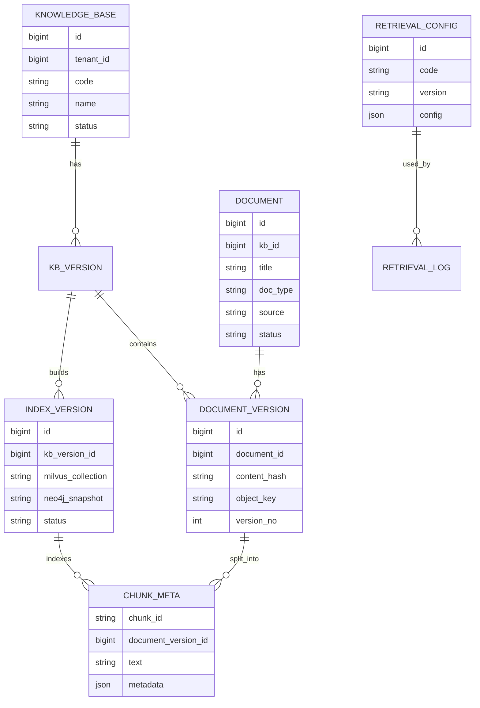
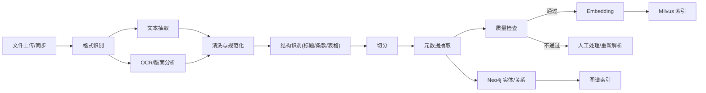
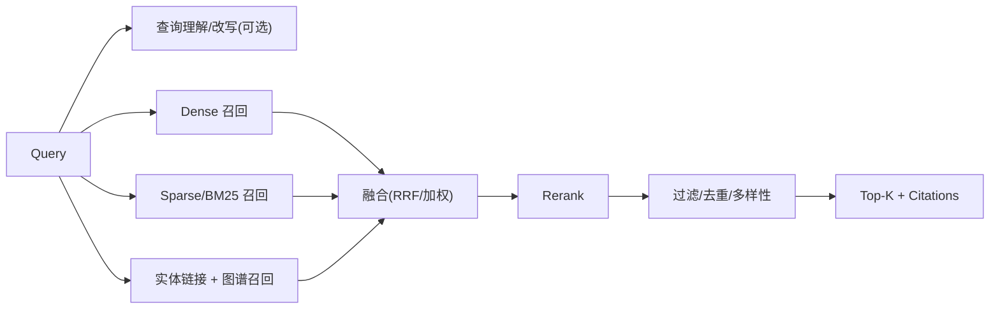

# 05 公共检索服务

## 1. 设计目标

1. 为不同业务线和 Agent 提供统一的文档接入、索引构建、混合召回、Rerank、引用溯源和图谱检索能力。
2. 同时支持语义相似（类案、法条解释）和关键词精确匹配（案号、法条序号、专有名词）。
3. 通过 Neo4j 补足实体关系和多跳推理能力，形成 GraphRAG。
4. 对知识库、索引、检索配置进行独立版本管理，支持灰度、回滚和可复现评测。
5. 保证文档级权限、租户隔离和引用可定位。

## 2. 能力清单

| 能力 | 说明 |
|---|---|
| 知识库管理 | 创建、配置、授权、版本、别名 |
| 文档接入 | PDF、DOCX、HTML、TXT、图片、扫描件 |
| 文档解析 | 文本抽取、OCR、版面分析、表格识别 |
| 切分与增强 | 结构感知切分、元数据抽取、摘要/关键词 |
| 向量索引 | dense + sparse/BM25 |
| 图谱索引 | 实体、关系、法条引用、类案关系 |
| 混合召回 | 多路召回、融合、去重 |
| 精排 | Rerank、阈值、多样性 |
| 引用溯源 | 文档、页码、段落、坐标、原文链接 |
| 检索配置 | 召回路数、权重、TopK、阈值、过滤条件 |
| 版本管理 | KB/索引/配置版本、别名、灰度、回滚 |
| 效果评测 | Recall、MRR、nDCG、引用准确率 |

## 3. 知识库与文档模型



### 3.1 知识库

| 字段 | 说明 |
|---|---|
| `tenant_id` | 所属租户 |
| `code` | 唯一编码 |
| `name` | 名称 |
| `description` | 说明 |
| `domain` | 业务域（法律法规、司法解释、案例、文书模板等） |
| `security_level` | 安全级别 |
| `embedding_model` | 向量模型及版本 |
| `chunk_config` | 切分配置 |
| `status` | `ACTIVE` / `DISABLED` |
| `owner` | 负责人 |

### 3.2 文档与文档版本

- 文档以 `content_hash` 去重；同一文档重新上传生成新版本，不覆盖历史。
- 文档状态：`UPLOADED` → `PARSING` → `PARSED` → `INDEXING` → `INDEXED` → `FAILED` / `DELETED`。
- 删除采用 tombstone，索引版本重建后物理清理。
- 原始文件保存在对象存储/NAS，数据库只保存元数据和对象 Key。

### 3.3 切分单元（Chunk）

| 字段 | 说明 |
|---|---|
| `chunk_id` | 全局唯一 ID |
| `document_version_id` | 文档版本 |
| `kb_id` / `tenant_id` | 归属 |
| `text` | 片段原文 |
| `chunk_type` | `paragraph` / `article` / `table` / `figure_caption` |
| `section_path` | 章节路径，如「第二章 > 第三节」 |
| `page_from` / `page_to` | 页码范围 |
| `bbox` | 坐标（可选） |
| `token_count` | Token 数 |
| `metadata` | 案由、法院、法条号、生效状态、发布日期等 |

## 4. 文档接入与解析

### 4.1 接入方式

1. **API 上传**：小文件直接上传。
2. **对象存储导入**：批量扫描指定目录/桶。
3. **业务系统同步**：通过 MCP 工具或数据同步任务增量拉取。
4. **人工录入**：管理控制台粘贴文本或上传文件。

所有接入方式统一进入异步解析流水线，返回 `job_id`。

### 4.2 解析流水线



### 4.3 格式处理

| 格式 | 处理方式 |
|---|---|
| PDF（文本型） | PyMuPDF/pdfplumber 抽取文本、页码、坐标 |
| PDF（扫描型） | 页面渲染为图片，OCR + 版面分析 |
| DOCX | python-docx 抽取段落、标题、表格 |
| HTML | 去导航/广告，保留正文与标题层级 |
| 图片 | OCR + 版面分析 + 方向校正 |
| 表格 | 独立抽取为结构化表格，保留表头与合并单元格信息 |

### 4.4 清洗规则

- 去除页眉、页脚、页码、水印、重复声明。
- 合并断行、修复连字符、统一全半角与标点。
- 去除控制字符和乱码；保留段落与条款结构。
- 识别并标记空白页、低质量 OCR 页。
- 保留原始文本与清洗后文本的映射，便于引用回定位。

### 4.5 切分策略

司法文档优先使用**结构感知切分**：

1. 按标题层级（章、节、条、款、项）切分。
2. 法条类文档以「第 X 条」为最小单元，过长时按款项拆分。
3. 裁判文书按「首部、事实、理由、裁判结果」分段，再按自然段切分。
4. 表格、图表单独成块，不跨表切分。
5. 普通段落建议 512–1024 Token，重叠 50–100 Token。
6. 每个 Chunk 保留 `section_path`、页码、前后文 ID，支持上下文扩展。

### 4.6 元数据抽取

建议抽取字段：

| 类别 | 字段 |
|---|---|
| 基础 | 标题、文号、发布机关、发布日期、生效日期、失效日期 |
| 法律 | 法律层级、法条号、章节、适用范围 |
| 案件 | 案号、案由、法院、审判程序、裁判日期、当事人（脱敏） |
| 业务 | 密级、所属业务域、来源系统、标签 |
| 质量 | OCR 置信度、解析器版本、切分配置版本 |

### 4.7 质量检查

- 文本为空或过短比例。
- OCR 平均置信度低于阈值。
- 乱码率、重复段落率。
- Chunk 长度分布异常。
- 文档哈希重复。
- 元数据缺失关键字段。

质量不通过的文档进入人工处理队列，不进入生产索引。

## 5. Milvus 向量索引

### 5.1 Collection 设计

```
collection: kb_chunks
fields:
  chunk_id        VARCHAR(64)   primary key
  tenant_id       INT64         partition key
  kb_id           INT64
  doc_id          VARCHAR(64)
  doc_version_id  INT64
  index_version   INT64
  text            VARCHAR(65535)
  dense           FLOAT_VECTOR(1024)
  sparse          SPARSE_FLOAT_VECTOR
  metadata        JSON
  created_at      INT64
```

说明：

- `tenant_id` 作为 partition key，默认 64 个分区；高安全租户可使用独立 collection。
- `text` 长度按实际模型与 Milvus 限制调整；超长文本拆分为多个 Chunk。
- `metadata` 存放可过滤字段：`doc_type`、`court_id`、`cause_code`、`effective`、`security_level`、`publish_date`、`section_path` 等。
- 为 `kb_id`、`doc_id`、`index_version`、`doc_type`、`security_level` 建立标量索引。

### 5.2 索引类型

| 向量 | 索引 | 参数 | 说明 |
|---|---|---|---|
| dense | HNSW | `M=16, efConstruction=200` | 低延迟、高召回 |
| sparse | SPARSE_INVERTED_INDEX | `drop_ratio_build=0.2` | 关键词/稀疏语义 |
| BM25 | 全文索引 | Milvus 版本支持时启用 | 精确词匹配 |
| scalar | INVERTED | - | 过滤字段 |

检索参数：

- `ef` 从 64 起，按召回与延迟调优。
- `nprobe` 若使用 IVF 系列，按数据量调整。
- 一致性级别使用 `Bounded`，允许短暂延迟以换取吞吐。

### 5.3 写入与更新

- 新文档先写入临时索引版本，构建完成后原子切换别名。
- 更新文档生成新 `doc_version_id`，旧版本保留到新版本验证通过。
- 删除通过 tombstone + 新索引版本实现，避免在线删除造成碎片。
- 批量导入使用分批写入（每批 500–2000 条），监控写入失败与重试。

### 5.4 稀疏与 BM25 选择

- 若 Milvus 版本支持 BM25 全文检索：优先使用内置 BM25，减少额外模型依赖。
- 若不支持：使用 BGE-M3 稀疏向量或独立稀疏编码器，写入 `sparse` 字段。
- 两套方案必须统一在检索配置中声明，索引版本记录实际使用的方案。

## 6. Neo4j 图谱索引

### 6.1 本体设计（v1）

| 节点 | 说明 |
|---|---|
| `Case` | 案件 |
| `Document` | 文书/法规/解释 |
| `Person` | 自然人（脱敏 ID） |
| `Organization` | 单位/机构 |
| `Court` | 法院 |
| `Law` | 法律 |
| `Article` | 法条 |
| `Charge` | 罪名 |
| `Cause` | 案由 |
| `LegalConcept` | 法律概念/争议焦点 |
| `Issue` | 裁判要点 |

| 关系 | 说明 |
|---|---|
| `CITES` | 文书引用法条 |
| `APPLIES` | 裁判适用法条 |
| `INVOLVES` | 案件涉及当事人/机构 |
| `HAS_CAUSE` | 案件案由 |
| `SIMILAR_TO` | 类案关系 |
| `RELATES_TO` | 概念关联 |
| `BELONGS_TO` | 法条属于法律 |
| `OVERRULES` | 新法/新解释废止旧法 |

### 6.2 约束与索引

```cypher
CREATE CONSTRAINT case_id IF NOT EXISTS FOR (c:Case) REQUIRE c.id IS UNIQUE;
CREATE CONSTRAINT doc_id IF NOT EXISTS FOR (d:Document) REQUIRE d.id IS UNIQUE;
CREATE CONSTRAINT law_id IF NOT EXISTS FOR (l:Law) REQUIRE l.id IS UNIQUE;
CREATE INDEX case_cause IF NOT EXISTS FOR (c:Case) ON (c.cause);
CREATE INDEX doc_title IF NOT EXISTS FOR (d:Document) ON (d.title);
CREATE INDEX article_no IF NOT EXISTS FOR (a:Article) ON (a.article_no);
```

### 6.3 GraphRAG 流程

1. **实体识别**：从查询中识别人名、机构、案由、法条、法律概念。
2. **实体链接**：通过别名表、同义词和向量相似度消歧。
3. **子图检索**：以命中实体为起点，按关系类型和深度（默认 2 跳）扩展，限制节点/边数量。
4. **路径排序**：按关系类型权重、节点重要性、与查询的相关性排序。
5. **文本化**：将路径转换为自然语言上下文，附带来源文档和 Chunk ID。
6. **融合**：图谱上下文与向量召回结果合并，进入 Rerank。
7. **降级**：图谱查询超时或失败时，仅返回向量召回结果，并在响应中标记 `graph_degraded=true`。

### 6.4 查询安全

- 所有 Cypher 使用参数化查询，禁止拼接用户输入。
- 查询必须带租户过滤；跨租户图谱默认隔离。
- 限制最大跳数、返回节点数和执行超时。
- 敏感关系（如当事人关系）按权限过滤或脱敏。
- 图谱写入只允许受信的数据治理流水线，业务方只读。

## 7. 混合召回与重排

### 7.1 召回路径



### 7.2 查询理解

- **可选**：使用小模型做查询改写、同义词扩展、法条号规范化。
- 对精确查询（案号、法条号）优先走关键词/BM25，避免改写丢失精确信息。
- 对长问题拆分为子问题，分别召回后合并。
- 查询改写必须可控、可关闭，并记录改写前后文本用于评测。

### 7.3 融合策略

| 方法 | 说明 | 适用 |
|---|---|---|
| RRF | 按排名融合，不依赖分数尺度 | 默认推荐 |
| 加权分数 | 各召回路归一化后加权 | 分数可比时 |
| 最大值 | 取最高分 | 简单场景 |
| 学习排序 | 使用特征训练 LTR | 数据充足后 |

RRF 公式：

```text
score(d) = Σ 1 / (k + rank_i(d))
```

默认 `k=60`，每路召回 Top 50–100。

### 7.4 Rerank

- 模型：BGE-Reranker-v2-M3。
- 输入：Query + Chunk 文本（必要时加入章节标题）。
- 批量：16–64，按延迟调优。
- 截断：超长 Chunk 截断到模型最大长度，保留开头和关键段落。
- 阈值：低于阈值的候选丢弃；若全部低于阈值，返回空结果或降级为融合分数。
- 降级：Rerank 超时（建议 300ms）时使用融合分数排序，并标记 `rerank_degraded=true`。

### 7.5 去重与多样性

- 按 `doc_id + text_hash` 去重。
- 同一文档最多返回 N 个 Chunk（默认 3），避免单一文档霸屏。
- 可选 MMR 提升结果多样性。
- 法条与案例可分开展示，由调用方决定上下文组装。

## 8. 引用溯源

### 8.1 引用结构

```json
{
  "document_id": "doc_1001",
  "document_version_id": 12,
  "title": "中华人民共和国民法典",
  "doc_no": "主席令第四十五号",
  "page": 12,
  "section_path": "第三编 合同 > 第二分编 典型合同 > 第十二章 借款合同",
  "chunk_id": "chk_1001_12_003",
  "snippet": "第六百八十条 禁止高利放贷……",
  "bbox": [120, 340, 560, 410],
  "source_url": "/api/v1/documents/doc_1001/content?version=12#page=12",
  "score": 0.87
}
```

### 8.2 要求

- 每个返回片段必须能回溯到原始文档版本、页码和 Chunk。
- 生成式回答只能引用检索结果中存在的引用 ID；引用不存在的来源视为幻觉。
- 引用片段应包含足够上下文，避免断章取义。
- 对 OCR 文档保留坐标，支持前端高亮。
- 引用链接需经过权限校验，未授权用户不可访问原文。
- 支持「引用覆盖检查」：回答中的关键结论是否有对应引用。

## 9. 版本管理

### 9.1 三类版本

| 版本 | 内容 | 变更时机 |
|---|---|---|
| `kb_version` | 文档集合、解析/切分配置、元数据 | 文档增删改、切分策略调整 |
| `index_version` | Milvus 索引快照、Neo4j 图谱快照 | 重建索引、换 Embedding 模型 |
| `retrieval_config_version` | 召回路数、权重、TopK、阈值、Rerank 参数 | 效果调优 |

### 9.2 别名

| 别名 | 用途 |
|---|---|
| `prod` | 生产默认 |
| `staging` | 预发验证 |
| `canary` | 灰度 |
| `latest` | 最新构建（不直接用于生产） |

别名切换是原子操作；检索请求可以只传别名，也可以显式指定三个版本。

### 9.3 构建与切换

1. 创建新 `kb_version`，导入/更新文档。
2. 解析、切分、质量检查。
3. 构建新 `index_version`（Milvus + Neo4j）。
4. 在评测集上跑离线评测。
5. 通过后切换 `staging` → 灰度 `canary` → `prod`。
6. 旧版本保留至少 30 天，支持回滚。

### 9.4 回滚

- 将别名指回旧版本，秒级生效。
- 新版本索引保留用于问题分析，不立即删除。
- 回滚记录写入审计，包含操作人、原因、影响范围。

## 10. 检索配置

```json
{
  "code": "legal-hybrid-v1",
  "version": "1.0.0",
  "top_k": 10,
  "recall": {
    "dense": {"enabled": true, "top_k": 100},
    "sparse": {"enabled": true, "top_k": 100},
    "bm25": {"enabled": true, "top_k": 100},
    "graph": {"enabled": true, "top_k": 30, "depth": 2}
  },
  "fusion": {
    "method": "rrf",
    "k": 60,
    "weights": {"dense": 1.0, "sparse": 0.8, "bm25": 0.8, "graph": 0.6}
  },
  "rerank": {
    "enabled": true,
    "model": "bge-reranker-v2-m3",
    "top_n": 50,
    "threshold": 0.2,
    "timeout_ms": 300
  },
  "filters": {
    "doc_status": ["effective"],
    "security_level_max": "INTERNAL"
  },
  "dedup": {"by": "doc_id", "max_per_doc": 3},
  "citation": {"enabled": true, "max_snippets": 5}
}
```

配置校验：

- `top_k` 不得超过系统上限（默认 50）。
- `rerank.top_n` 不得超过 Rerank 服务批量上限。
- 权重非负；RRF 模式下权重可为空。
- 过滤字段必须在索引 schema 中存在。
- 配置发布后不可修改，需新版本。

## 11. 权限与数据隔离

### 11.1 隔离层级

| 层级 | 方式 |
|---|---|
| 租户 | `tenant_id` 过滤 + partition key；高安全租户独立 collection |
| 知识库 | `kb_id` 过滤 + 授权 |
| 文档 | 文档 ACL / 密级 / 部门 |
| Chunk | 继承文档权限 |

### 11.2 权限模型

- **RBAC**：租户、应用、角色、能力授权。
- **ABAC**：密级、部门、案件类型、法院、时间范围。
- 检索请求必须携带调用方身份，服务端注入权限过滤，禁止客户端自行决定。
- 对高密级文档，采用「先过滤后召回」；若 ACL 列表过大，使用权限标签 + 后置校验。
- 返回引用前再次校验原文访问权限。

### 11.3 多租户注意事项

- 缓存键必须包含租户与权限范围。
- 禁止跨租户共享检索结果缓存。
- 日志中不记录完整敏感文本。
- 高安全租户可独立部署检索服务与索引。

## 12. 缓存

| 缓存 | 键 | TTL | 说明 |
|---|---|---|---|
| Query Embedding | `emb:{model}:{hash(query)}` | 1h | 不含租户敏感信息或按租户隔离 |
| 检索结果 | `ret:{tenant}:{kb}:{versions}:{hash(query+filters)}` | 5min | 版本切换时主动失效 |
| Rerank 结果 | `rr:{model}:{hash(query+chunk)}` | 10min | 可选 |
| 文档元数据 | `doc:{doc_id}:{version}` | 10min | 原文不缓存到 Redis |

要求：

- 缓存必须可关闭；敏感场景默认关闭结果缓存。
- 缓存命中率、失效事件纳入监控。
- 版本别名切换时广播失效。

## 13. 检索效果评测

### 13.1 评测集

每条样本包含：

```json
{
  "query": "民间借贷利率超过多少不受法律保护",
  "relevant_chunk_ids": ["chk_1001_12_003"],
  "relevant_doc_ids": ["doc_1001"],
  "expected_answer_points": ["合同成立时一年期LPR的四倍"],
  "must_cite": ["doc_1001"],
  "filters": {"doc_type": ["law", "judicial_interpretation"]}
}
```

### 13.2 指标

| 指标 | 说明 | 目标（建议） |
|---|---|---|
| Recall@10 | Top-10 中命中相关片段的比例 | ≥ 0.90 |
| Precision@5 | Top-5 中相关片段比例 | ≥ 0.70 |
| MRR | 首个相关结果排名倒数 | ≥ 0.80 |
| nDCG@10 | 排序质量 | ≥ 0.80 |
| 引用准确率 | 引用片段可定位且支撑结论 | ≥ 0.95 |
| 空结果率 | 无召回比例 | 按场景监控 |
| 平均延迟 | 检索 + 重排 | P95 ≤ 500ms |

### 13.3 评测流程

1. 固定 KB/索引/配置版本。
2. 跑离线评测，输出整体与分场景指标。
3. 对比新旧版本，分析召回失败原因（解析、切分、Embedding、融合、Rerank）。
4. 通过门槛后进入灰度。
5. 灰度期间收集线上反馈与 Bad Case。

## 14. 接口设计

### 14.1 检索接口

```http
POST /v1/retrieve
Authorization: Bearer <token>
Content-Type: application/json
```

```json
{
  "kb_ids": [1001],
  "query": "民间借贷利率上限",
  "kb_version": "prod",
  "index_version": "prod",
  "config_version": "legal-hybrid-v1",
  "top_k": 10,
  "filters": {
    "doc_type": ["law", "judicial_interpretation"],
    "effective": true
  },
  "with_graph": true,
  "with_citation": true
}
```

```json
{
  "request_id": "req-20261019-1001",
  "query": "民间借贷利率上限",
  "results": [
    {
      "chunk_id": "chk_1001_12_003",
      "doc_id": "doc_1001",
      "doc_version_id": 12,
      "text": "第六百八十条 禁止高利放贷……",
      "score": 0.92,
      "rerank_score": 0.88,
      "recall_sources": ["dense", "sparse"],
      "metadata": {
        "doc_type": "law",
        "section_path": "第三编 合同 > 第十二章 借款合同"
      },
      "citation": {
        "title": "中华人民共和国民法典",
        "page": 12,
        "snippet": "第六百八十条 禁止高利放贷……",
        "source_url": "/api/v1/documents/doc_1001/content?version=12#page=12"
      }
    }
  ],
  "graph": {
    "entities": [{"id": "law_001", "name": "民法典", "type": "Law"}],
    "paths": [
      {"from": "民法典", "relation": "BELONGS_TO", "to": "借款合同", "weight": 0.9}
    ],
    "degraded": false
  },
  "versions": {
    "kb": "kb-v20261001",
    "index": "idx-v12",
    "config": "legal-hybrid-v1"
  },
  "usage": {
    "recall_ms": 80,
    "graph_ms": 45,
    "rerank_ms": 120,
    "total_ms": 245
  }
}
```

### 14.2 管理接口

| 方法 | 路径 | 说明 |
|---|---|---|
| `POST` | `/api/v1/kbs` | 创建知识库 |
| `GET` | `/api/v1/kbs` | 查询知识库 |
| `POST` | `/api/v1/kbs/{id}/documents` | 上传/登记文档 |
| `POST` | `/api/v1/kbs/{id}/parse-jobs` | 创建解析任务 |
| `POST` | `/api/v1/kbs/{id}/index-jobs` | 创建索引构建任务 |
| `GET` | `/api/v1/jobs/{id}` | 查询任务状态 |
| `GET` | `/api/v1/kbs/{id}/versions` | 版本列表 |
| `POST` | `/api/v1/kbs/{id}/aliases` | 切换别名 |
| `POST` | `/api/v1/kbs/{id}/rollback` | 回滚 |
| `POST` | `/api/v1/retrieval-configs` | 创建检索配置 |
| `POST` | `/api/v1/retrieval-evals` | 创建离线评测 |

### 14.3 异步任务状态

```json
{
  "job_id": "job-20261019-001",
  "type": "INDEX_BUILD",
  "status": "RUNNING",
  "progress": {
    "total": 10000,
    "processed": 4200,
    "failed": 3
  },
  "started_at": "2026-10-19T10:00:00+08:00",
  "estimated_end_at": "2026-10-19T10:20:00+08:00",
  "error": null
}
```

## 15. 验收标准

1. 支持 PDF、DOCX、HTML、TXT、图片、扫描件的解析，解析成功率达到约定基线。
2. 文档切分保留章节、条款、页码和坐标，引用可定位到原文。
3. Milvus 支持 dense + sparse/BM25 混合召回，Neo4j 支持 2 跳图谱扩展。
4. 检索接口返回 Top-K、分数、召回来源、引用和版本信息。
5. 检索配置、知识库、索引可独立版本化，别名切换和回滚秒级生效。
6. 权限过滤在召回前生效，跨租户不可见；引用原文访问再次鉴权。
7. 评测集 Recall@10 ≥ 0.90，引用准确率 ≥ 0.95（以双方确认的评测集为准）。
8. 检索 + 重排 P95 ≤ 500ms（Top-50 候选，单知识库）。
9. 图谱或 Rerank 故障时自动降级，主链路可用。
10. 索引构建支持断点续跑、失败重试和进度查询。
