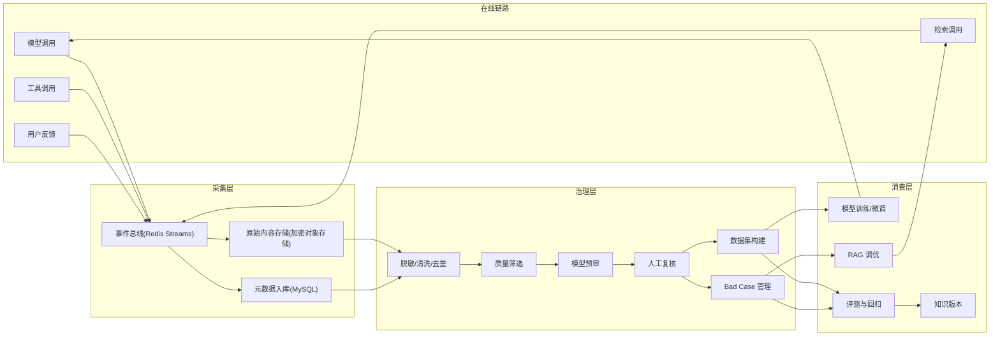
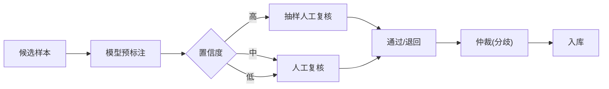
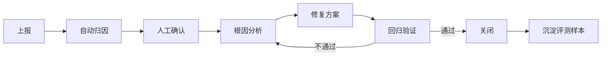

# 06 AI 数据治理闭环

## 1. 设计目标

1. 把模型输出、用户反馈、检索记录和人工复核结果统一采集，形成可持续的数据资产。
2. 通过质量筛选、模型预审和人工复核，把原始日志转化为高质量训练集、评测集、Bad Case 数据集和知识版本。
3. 保证数据可追溯、可复现、可审计，满足司法数据安全与合规要求。
4. 建立「反馈 → 定位 → 修复 → 回归 → 发布」的闭环，驱动模型和 RAG 持续迭代。

## 2. 数据来源

| 来源 | 内容 | 采集方式 |
|---|---|---|
| 模型调用日志 | Prompt、输出、模型/Adapter 版本、Token、延迟、状态 | 网关异步事件 |
| 检索日志 | Query、召回片段、分数、引用、版本 | 检索服务异步事件 |
| 用户反馈 | 点赞/点踩、评分、修改后文本、问题类型 | 业务方调用反馈 API |
| 业务结果 | 采纳、修改、驳回、转人工 | 业务系统回调 |
| 人工复核 | 标注、纠错、审核意见 | 标注平台 |
| 评测结果 | 指标、失败样本、对比报告 | 评测服务 |
| 工具调用 | 工具名、参数摘要、结果状态、耗时 | MCP Hub 审计 |
| 知识变更 | 文档新增、修订、失效 | 知识库流水线 |

## 3. 闭环架构



## 4. 事件采集

### 4.1 事件类型

| 事件 | 触发点 | 关键字段 |
|---|---|---|
| `INFERENCE_COMPLETED` | 模型调用结束 | request_id、capability、version、usage、latency、status |
| `RETRIEVAL_COMPLETED` | 检索结束 | query_hash、kb/index/config version、chunk_ids、scores |
| `TOOL_CALLED` | 工具调用结束 | tool、params_hash、status、latency |
| `FEEDBACK_SUBMITTED` | 用户反馈 | request_id、rating、reason、corrected_output |
| `BUSINESS_OUTCOME` | 业务采纳/修改/驳回 | request_id、outcome、diff |
| `ANNOTATION_COMPLETED` | 人工复核完成 | item_id、label、reviewer、confidence |
| `EVAL_COMPLETED` | 评测结束 | dataset_version、metrics、failures |

### 4.2 事件结构

```json
{
  "event_id": "evt-20261019-0001",
  "event_type": "INFERENCE_COMPLETED",
  "tenant_id": 1001,
  "app_id": 2001,
  "request_id": "req-20261019-0001",
  "trace_id": "trace-abc",
  "capability": "llm.qwen3.chat",
  "capability_version": "1.0.0",
  "model": "Qwen3-8B",
  "adapter": "judicial-case-classify",
  "input_ref": "oss://ai-raw/2026/10/19/req-0001.in.enc",
  "output_ref": "oss://ai-raw/2026/10/19/req-0001.out.enc",
  "input_hash": "sha256:...",
  "output_hash": "sha256:...",
  "usage": {"input_tokens": 128, "output_tokens": 256},
  "latency_ms": 1832,
  "status": "SUCCESS",
  "security_level": "INTERNAL",
  "created_at": "2026-10-19T10:00:00+08:00"
}
```

设计原则：

- 事件流只传元数据和加密后的对象引用，不在 Redis/日志中传完整敏感文本。
- 原始内容加密存储在受控对象存储，访问需审批与审计。
- 事件 ID 幂等，消费者按 `event_id` 去重。
- 事件保留时间按合规策略配置，默认 180 天，训练数据例外需单独审批。

### 4.3 采集可靠性

- 生产者使用 Outbox 或本地缓冲 + 重试，避免事件丢失。
- Redis Streams 使用消费者组，失败进入死信队列。
- 消费者幂等：`event_id` 唯一索引。
- 监控积压量、消费延迟、失败率。
- 支持按时间范围重放事件。

## 5. 脱敏与清洗

### 5.1 脱敏规则

| 类型 | 示例 | 处理 |
|---|---|---|
| 自然人姓名 | 张三 | 替换为 `[姓名]` 或假名映射 |
| 身份证号 | 110101... | 掩码/哈希 |
| 手机号 | 138... | 掩码 |
| 地址 | 详细住址 | 泛化到区县 |
| 银行账号 | - | 掩码 |
| 未成年人信息 | - | 强化脱敏，限制使用 |
| 商业秘密 | - | 按密级过滤 |
| 案号 | （2026）... | 按策略保留或哈希 |

要求：

- 脱敏在数据进入训练/评测数据集前完成，原始数据单独隔离。
- 脱敏映射表加密存储，仅授权人员可访问；训练数据不保留可逆映射。
- 脱敏规则版本化，记录在数据集版本中。
- 支持正则、词典、NER 模型三种方式组合；NER 漏检需人工抽检。

### 5.2 清洗

- 去除 HTML 标签、控制字符、重复空白。
- 统一编码、标点、全半角。
- 修复截断、乱码、错位。
- 去除系统提示、调试信息、内部 URL。
- 标记拒答、空输出、异常中断样本。

### 5.3 去重

- 精确去重：`input_hash + output_hash`。
- 近似去重：SimHash/MinHash，海明距离阈值可配置。
- 跨数据集去重：训练集与评测集必须隔离，防止泄漏。
- 保留重复样本的来源列表，便于追溯。

## 6. 质量筛选

### 6.1 规则筛选

| 维度 | 规则示例 |
|---|---|
| 完整性 | 输入/输出非空；输出未被截断 |
| 格式 | JSON 可解析；字段齐全；符合 Schema |
| 语言 | 中文占比、乱码率 |
| 长度 | 输入/输出长度在合理范围 |
| 引用 | 生成类样本必须包含引用或可验证来源 |
| 安全 | 无敏感信息、无有害内容、无越权回答 |
| 一致性 | 输出与检索片段不矛盾 |
| 业务 | 案由、法条、程序等字段合法 |

### 6.2 模型筛选

| 模型 | 用途 |
|---|---|
| 质量打分模型 | 对回答的完整性、相关性、专业性打分 |
| 事实一致性模型 | 判断回答是否被引用片段支撑 |
| 安全分类模型 | 检测敏感、有害、越权内容 |
| 去重/聚类模型 | 发现近重复与长尾分布 |

### 6.3 综合质量分

```text
quality_score =
  0.30 × 规则通过率
+ 0.25 × 模型质量分
+ 0.25 × 人工复核分
+ 0.10 × 引用支撑率
+ 0.10 × 业务采纳信号
```

阈值建议：

- `≥ 0.80`：可直接进入候选数据集。
- `0.60–0.80`：进入人工抽检。
- `< 0.60`：进入 Bad Case 或丢弃。

阈值需按任务类型分别校准，不能一刀切。

### 6.4 数据分布检查

- 按任务、案由、文档类型、法院、时间分布统计。
- 避免单一来源占比过高。
- 长尾样本单独保留，不被高频样本淹没。
- 训练/验证/测试集按来源或时间切分，避免同源泄漏。

## 7. 模型预审与人工复核

### 7.1 预审流程



### 7.2 预审策略

- **分类/抽取**：模型给出标签和置信度；高置信度抽检，低置信度全检。
- **生成质量**：LLM-as-Judge 按评分细则打分；建议双模型交叉评审，降低单模型偏见。
- **安全**：高风险类别全检，不允许仅依赖模型。
- **引用**：自动检查引用 ID 是否存在、片段是否支撑结论；不通过进入人工。

### 7.3 人工复核

| 要求 | 说明 |
|---|---|
| 任务分配 | 按领域、难度、负载分配 |
| 双人复核 | 评测集和关键训练集采用双盲 |
| 仲裁 | 分歧由资深审核员裁决 |
| 一致性 | 计算 Cohen's Kappa / 一致率，低于阈值需培训 |
| 留痕 | 记录复核人、时间、意见、修改前后内容 |
| 防泄漏 | 审核员只能看到授权范围内的数据 |

### 7.4 标注平台能力

- 任务池、领取、锁定、提交、退回。
- 富文本/表格/对话/引用对照视图。
- 快捷键与批量操作。
- 质量抽检与申诉。
- 统计面板：进度、通过率、一致性、人均产出。

## 8. 数据集管理

### 8.1 数据集类型

| 类型 | 用途 | 格式 |
|---|---|---|
| `SFT` | 指令微调 | JSONL: instruction/input/output |
| `PREFERENCE` | 偏好对齐（DPO 等） | prompt/chosen/rejected |
| `EVAL` | 效果评测 | input/reference/criteria |
| `RETRIEVAL_EVAL` | 检索评测 | query/relevant_chunk_ids |
| `BAD_CASE` | 问题样本库 | 问题分类/根因/修复状态 |
| `KNOWLEDGE` | 知识资产 | QA/法条/裁判要点 |
| `SAFETY` | 安全评测 | 对抗样本/期望行为 |

### 8.2 数据集版本

| 字段 | 说明 |
|---|---|
| `dataset_id` | 数据集 |
| `version` | 版本号（日期+序号） |
| `source_snapshot` | 来源事件时间范围与过滤条件 |
| `filter_config` | 质量筛选/脱敏/去重配置 |
| `prelabel_model` | 预审模型及版本 |
| `stats` | 样本数、分布、重复率、通过率 |
| `code_commit` | 生成脚本版本 |
| `created_by` / `approved_by` | 创建人与审批人 |
| `status` | `DRAFT` / `REVIEWING` / `PUBLISHED` / `ARCHIVED` |

规则：

- 数据集版本发布后不可修改，新增样本生成新版本。
- 每个版本必须能复现：来源、过滤规则、脚本、随机种子。
- 训练/评测/验证集划分固定，跨版本保持可比性。
- 导出需审批、加密、带水印和使用范围说明。

### 8.3 数据血缘

```text
原始事件 → 脱敏任务 → 质量筛选 → 预审模型 → 人工复核 → 数据集版本 → 训练任务/评测任务
```

每个环节记录：

- 输入/输出数据版本。
- 处理配置与代码版本。
- 操作人与时间。
- 统计指标与异常。

## 9. Bad Case 管理

### 9.1 来源

- 用户点踩、低评分、修改后文本。
- 人工抽检发现的问题。
- 评测失败样本。
- 线上监控异常（超时、拒答、引用错误）。
- 业务方反馈。

### 9.2 分类体系

| 一级分类 | 二级示例 |
|---|---|
| 检索问题 | 未召回、召回错误、排序不佳、引用缺失 |
| 生成问题 | 幻觉、答非所问、遗漏要点、格式错误 |
| 引用问题 | 引用不存在、引用不支撑、页码错误 |
| 理解问题 | 意图识别错误、实体识别错误 |
| 工具问题 | 参数错误、超时、结果解析失败 |
| 数据问题 | 文档过期、解析错误、切分错误 |
| 安全问题 | 越权、敏感信息、Prompt 注入 |
| 体验问题 | 延迟高、截断、重复 |

### 9.3 处理流程



要求：

- 每个 Bad Case 必须有负责人、优先级、根因、修复链接。
- 修复后必须加入回归集，防止复发。
- 统计关闭率、平均关闭时长、复发率。
- 对高频问题做专项治理，而不是逐条修补。

## 10. 评测与发布门禁

### 10.1 评测集

- 每个任务维护固定评测集，版本化。
- 评测集覆盖高频、长尾、边界、对抗和安全样本。
- 评测集不参与训练，定期补充新 Bad Case。
- 评测指标与业务指标对齐。

### 10.2 发布门禁

| 门禁 | 要求 |
|---|---|
| 效果 | 核心指标不低于基线，关键场景达到目标 |
| 安全 | 无高危问题；敏感信息泄漏率为 0 |
| 引用 | 引用准确率达到目标 |
| 性能 | 延迟、吞吐不劣化超过阈值 |
| 回归 | 历史 Bad Case 通过率达标 |
| 合规 | 数据来源、授权、审批完整 |

未通过门禁的模型/Adapter/检索配置不得进入生产。

### 10.3 灰度与监控

- 灰度期间对比新旧版本的效果、延迟、用户反馈。
- 设置自动回滚阈值：错误率、点踩率、引用错误率、P95 延迟。
- 灰度结束后输出评估报告，决定全量或回滚。

## 11. 数据资产指标

| 指标 | 说明 |
|---|---|
| 数据总量 | 可用训练/评测/Bad Case 样本数 |
| 数据增长率 | 每月新增有效样本 |
| 数据质量分 | 平均质量分与分布 |
| 标注一致性 | Kappa/一致率 |
| 复核通过率 | 人工复核通过比例 |
| 反馈覆盖率 | 有反馈的调用占比 |
| Bad Case 关闭率 | 已关闭/总数 |
| 平均关闭时长 | 从上报到关闭 |
| 复发率 | 同类问题再次出现比例 |
| 数据集使用率 | 被训练/评测任务引用的比例 |

## 12. 合规与保留

1. **目的限制**：数据只能用于已声明的模型优化、评测和知识建设。
2. **最小必要**：只采集与改进相关的字段，避免全量留存无关信息。
3. **分级授权**：按密级控制访问；高密级数据独立存储。
4. **加密**：传输 TLS，静态加密；密钥独立管理。
5. **保留期限**：原始日志默认 180 天；训练集按项目周期；到期删除或匿名化。
6. **删除权**：支持按案件/当事人/租户删除相关数据，并记录删除证明。
7. **导出审批**：数据集导出需审批、加密、水印和用途登记。
8. **审计**：所有访问、导出、删除操作留痕。
9. **模型训练合规**：训练数据来源合法，保留授权与审批记录。
10. **供应商管理**：外部标注/训练服务需签署保密协议，禁止数据外带。

## 13. 接口与数据表

### 13.1 反馈接口

```http
POST /api/v1/feedback
Authorization: Bearer <token>
Content-Type: application/json
```

```json
{
  "request_id": "req-20261019-0001",
  "rating": "NEGATIVE",
  "reason": "CITATION_ERROR",
  "comment": "引用的法条与结论不一致",
  "corrected_output": "……",
  "tags": ["citation", "legal_article"]
}
```

### 13.2 数据集接口

| 方法 | 路径 | 说明 |
|---|---|---|
| `POST` | `/api/v1/datasets` | 创建数据集 |
| `GET` | `/api/v1/datasets` | 查询数据集 |
| `POST` | `/api/v1/datasets/{id}/versions` | 生成版本 |
| `GET` | `/api/v1/datasets/{id}/versions` | 版本列表 |
| `POST` | `/api/v1/dataset-versions/{id}/publish` | 发布版本 |
| `POST` | `/api/v1/dataset-versions/{id}/export` | 导出（需审批） |
| `POST` | `/api/v1/bad-cases` | 上报 Bad Case |
| `PATCH` | `/api/v1/bad-cases/{id}` | 更新状态/根因 |
| `POST` | `/api/v1/annotation-tasks` | 创建标注任务 |
| `POST` | `/api/v1/evals` | 创建评测任务 |

### 13.3 核心数据表

| 表 | 说明 |
|---|---|
| `ai_event` | 原始事件元数据 |
| `feedback` | 用户反馈 |
| `bad_case` | Bad Case |
| `annotation_task` | 标注任务 |
| `annotation_record` | 标注记录 |
| `dataset` | 数据集 |
| `dataset_version` | 数据集版本 |
| `dataset_item` | 数据集样本 |
| `dataset_lineage` | 数据血缘 |
| `eval_task` | 评测任务 |
| `eval_result` | 评测结果 |
| `retention_job` | 数据保留/清理任务 |

详细字段见 [08-数据模型与接口设计](08-数据模型与接口设计.md)。

## 14. 验收标准

1. 模型、检索、工具、反馈事件可稳定采集，事件不丢、可重放、可幂等消费。
2. 原始内容加密存储，事件流与日志不含明文敏感信息。
3. 脱敏、去重、质量筛选流水线可配置、可版本化、可审计。
4. 模型预审 + 人工复核流程可用，支持双人复核与仲裁。
5. 可生成 SFT、评测、Bad Case 等数据集版本，并记录完整血缘。
6. Bad Case 从上报到关闭全流程可追踪，修复样本自动进入回归集。
7. 数据集导出需审批、加密、水印，访问有审计。
8. 数据保留与删除策略可执行，删除有证明。
9. 质量指标、标注一致性、闭环效率可在控制台查看。
10. 基于千万级司法业务数据可持续构建训练集、评测集和 Bad Case 资产（以实际数据接入规模验证）。
