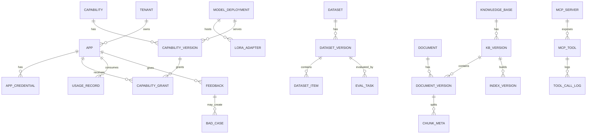

# 08 数据模型与接口设计

## 1. 设计约定

### 1.1 通用约定

| 项 | 约定 |
|---|---|
| 数据库 | MySQL 8.0+，`utf8mb4`，`utf8mb4_0900_ai_ci` |
| 表名 | 小写蛇形，业务表带模块前缀，如 `capability_version` |
| 主键 | `BIGINT`，雪花 ID 或号段生成；不使用自增暴露业务规模 |
| 租户 | 所有业务表包含 `tenant_id`；全局资源使用 `tenant_id=0` |
| 时间 | `DATETIME(3)`，统一 UTC 存储，接口返回 ISO 8601 带时区 |
| 软删除 | `deleted_at DATETIME(3) NULL`；查询默认过滤 |
| 外键 | 不使用物理外键，应用层保证一致性；关键关系建索引 |
| JSON | 仅用于扩展字段和配置；高频过滤字段必须拆列 |
| 金额/比例 | `DECIMAL`，避免浮点误差 |
| 日志表 | 按月分区或按时间归档 |
| 乐观锁 | 关键配置表使用 `version_no` 或 `updated_at` 条件更新 |

### 1.2 命名规范

- 能力编码：`{domain}.{subject}.{action}`，如 `llm.qwen3.chat`、`rag.legal.retrieve`。
- 版本：SemVer，如 `1.2.0`、`1.3.0-rc.1`。
- 错误码：大写下划线，如 `CAPABILITY_NOT_FOUND`。
- 事件：大写下划线，如 `INFERENCE_COMPLETED`。
- Redis 键：`{module}:{entity}:{id}`，冒号分隔。

## 2. 核心 ER 图



## 3. MySQL 核心表

> 以下 DDL 为设计基线，实际实现时需补充字段注释、字符集、分区和索引；迁移使用 Alembic/Flyway 管理。

### 3.1 租户与应用

```sql
CREATE TABLE tenant (
  id            BIGINT       NOT NULL,
  code          VARCHAR(64)  NOT NULL,
  name          VARCHAR(128) NOT NULL,
  type          VARCHAR(32)  NOT NULL COMMENT 'COMPANY/COURT/PROJECT',
  status        VARCHAR(16)  NOT NULL DEFAULT 'ACTIVE',
  contact       VARCHAR(128) NULL,
  metadata      JSON         NULL,
  created_at    DATETIME(3)  NOT NULL DEFAULT CURRENT_TIMESTAMP(3),
  updated_at    DATETIME(3)  NOT NULL DEFAULT CURRENT_TIMESTAMP(3) ON UPDATE CURRENT_TIMESTAMP(3),
  deleted_at    DATETIME(3)  NULL,
  PRIMARY KEY (id),
  UNIQUE KEY uk_tenant_code (code)
) ENGINE=InnoDB DEFAULT CHARSET=utf8mb4;

CREATE TABLE app (
  id            BIGINT       NOT NULL,
  tenant_id     BIGINT       NOT NULL,
  code          VARCHAR(64)  NOT NULL,
  name          VARCHAR(128) NOT NULL,
  type          VARCHAR(32)  NOT NULL COMMENT 'SYSTEM/AGENT/APP/JOB',
  owner         VARCHAR(64)  NOT NULL,
  status        VARCHAR(16)  NOT NULL DEFAULT 'ACTIVE',
  description   VARCHAR(512) NULL,
  metadata      JSON         NULL,
  created_at    DATETIME(3)  NOT NULL DEFAULT CURRENT_TIMESTAMP(3),
  updated_at    DATETIME(3)  NOT NULL DEFAULT CURRENT_TIMESTAMP(3) ON UPDATE CURRENT_TIMESTAMP(3),
  deleted_at    DATETIME(3)  NULL,
  PRIMARY KEY (id),
  UNIQUE KEY uk_app_tenant_code (tenant_id, code),
  KEY idx_app_tenant (tenant_id)
) ENGINE=InnoDB DEFAULT CHARSET=utf8mb4;

CREATE TABLE app_credential (
  id            BIGINT       NOT NULL,
  app_id        BIGINT       NOT NULL,
  credential_type VARCHAR(16) NOT NULL COMMENT 'API_KEY/OAUTH2/MTLS',
  key_hash      VARCHAR(128) NOT NULL,
  key_prefix    VARCHAR(16)  NOT NULL,
  status        VARCHAR(16)  NOT NULL DEFAULT 'ACTIVE',
  expires_at    DATETIME(3)  NULL,
  last_used_at  DATETIME(3)  NULL,
  created_by    BIGINT       NOT NULL,
  created_at    DATETIME(3)  NOT NULL DEFAULT CURRENT_TIMESTAMP(3),
  PRIMARY KEY (id),
  UNIQUE KEY uk_credential_hash (key_hash),
  KEY idx_credential_app (app_id)
) ENGINE=InnoDB DEFAULT CHARSET=utf8mb4;
```

### 3.2 能力与授权

```sql
CREATE TABLE capability (
  id            BIGINT       NOT NULL,
  tenant_id     BIGINT       NOT NULL DEFAULT 0,
  code          VARCHAR(128) NOT NULL,
  name          VARCHAR(128) NOT NULL,
  type          VARCHAR(32)  NOT NULL,
  scope         VARCHAR(16)  NOT NULL COMMENT 'GLOBAL/TENANT',
  owner         VARCHAR(64)  NOT NULL,
  description   VARCHAR(1024) NULL,
  status        VARCHAR(16)  NOT NULL DEFAULT 'DRAFT',
  tags          JSON         NULL,
  created_at    DATETIME(3)  NOT NULL DEFAULT CURRENT_TIMESTAMP(3),
  updated_at    DATETIME(3)  NOT NULL DEFAULT CURRENT_TIMESTAMP(3) ON UPDATE CURRENT_TIMESTAMP(3),
  deleted_at    DATETIME(3)  NULL,
  PRIMARY KEY (id),
  UNIQUE KEY uk_capability_tenant_code (tenant_id, code),
  KEY idx_capability_type_status (type, status)
) ENGINE=InnoDB DEFAULT CHARSET=utf8mb4;

CREATE TABLE capability_version (
  id                  BIGINT       NOT NULL,
  capability_id       BIGINT       NOT NULL,
  version             VARCHAR(32)  NOT NULL,
  status              VARCHAR(16)  NOT NULL DEFAULT 'DRAFT',
  protocol            VARCHAR(16)  NOT NULL COMMENT 'OPENAI/PLATFORM/MCP',
  endpoint            VARCHAR(512) NULL,
  model_deployment_id BIGINT       NULL,
  model_name          VARCHAR(128) NULL,
  adapter_alias       VARCHAR(128) NULL,
  request_schema      JSON         NOT NULL,
  response_schema     JSON         NOT NULL,
  default_timeout_ms  INT          NOT NULL DEFAULT 60000,
  max_timeout_ms      INT          NOT NULL DEFAULT 120000,
  max_input_tokens    INT          NULL,
  max_output_tokens   INT          NULL,
  qps_limit           INT          NULL,
  concurrency_limit   INT          NULL,
  retry_policy        JSON         NULL,
  health_check        JSON         NULL,
  security_level      VARCHAR(16)  NOT NULL DEFAULT 'INTERNAL',
  published_at        DATETIME(3)  NULL,
  created_by          BIGINT       NOT NULL,
  created_at          DATETIME(3)  NOT NULL DEFAULT CURRENT_TIMESTAMP(3),
  PRIMARY KEY (id),
  UNIQUE KEY uk_cap_version (capability_id, version),
  KEY idx_cap_version_status (capability_id, status)
) ENGINE=InnoDB DEFAULT CHARSET=utf8mb4;

CREATE TABLE capability_grant (
  id                    BIGINT      NOT NULL,
  tenant_id             BIGINT      NOT NULL,
  app_id                BIGINT      NOT NULL,
  capability_id         BIGINT      NOT NULL,
  capability_version_id BIGINT      NULL COMMENT 'NULL 表示所有已发布版本',
  env                   VARCHAR(16) NOT NULL DEFAULT 'prod',
  quota                 JSON        NULL,
  data_scope            JSON        NULL,
  status                VARCHAR(16) NOT NULL DEFAULT 'ACTIVE',
  expires_at            DATETIME(3) NULL,
  created_by            BIGINT      NOT NULL,
  created_at            DATETIME(3) NOT NULL DEFAULT CURRENT_TIMESTAMP(3),
  PRIMARY KEY (id),
  UNIQUE KEY uk_grant (app_id, capability_id, capability_version_id, env),
  KEY idx_grant_app (app_id, status)
) ENGINE=InnoDB DEFAULT CHARSET=utf8mb4;
```

### 3.3 模型与 Adapter

```sql
CREATE TABLE model_deployment (
  id                BIGINT       NOT NULL,
  code              VARCHAR(64)  NOT NULL,
  name              VARCHAR(128) NOT NULL,
  engine            VARCHAR(32)  NOT NULL DEFAULT 'VLLM',
  base_model        VARCHAR(128) NOT NULL,
  base_model_version VARCHAR(64) NOT NULL,
  endpoint          VARCHAR(512) NOT NULL,
  gpu_pool          VARCHAR(64)  NULL,
  replicas          INT          NOT NULL DEFAULT 1,
  max_concurrency   INT          NULL,
  max_model_len     INT          NULL,
  status            VARCHAR(16)  NOT NULL DEFAULT 'ACTIVE',
  health_status     VARCHAR(16)  NOT NULL DEFAULT 'UNKNOWN',
  metadata          JSON         NULL,
  created_at        DATETIME(3)  NOT NULL DEFAULT CURRENT_TIMESTAMP(3),
  updated_at        DATETIME(3)  NOT NULL DEFAULT CURRENT_TIMESTAMP(3) ON UPDATE CURRENT_TIMESTAMP(3),
  PRIMARY KEY (id),
  UNIQUE KEY uk_deployment_code (code)
) ENGINE=InnoDB DEFAULT CHARSET=utf8mb4;

CREATE TABLE lora_adapter (
  id                      BIGINT       NOT NULL,
  alias                   VARCHAR(128) NOT NULL,
  base_model              VARCHAR(128) NOT NULL,
  base_model_version      VARCHAR(64)  NOT NULL,
  path                    VARCHAR(512) NOT NULL,
  rank                    INT          NOT NULL,
  target_modules          JSON         NULL,
  training_dataset_version VARCHAR(64) NULL,
  eval_report_id          BIGINT       NULL,
  checksum                VARCHAR(128) NULL,
  status                  VARCHAR(16)  NOT NULL DEFAULT 'REGISTERED',
  owner                   VARCHAR(64)  NOT NULL,
  created_at              DATETIME(3)  NOT NULL DEFAULT CURRENT_TIMESTAMP(3),
  updated_at              DATETIME(3)  NOT NULL DEFAULT CURRENT_TIMESTAMP(3) ON UPDATE CURRENT_TIMESTAMP(3),
  PRIMARY KEY (id),
  UNIQUE KEY uk_adapter_alias_base (alias, base_model_version)
) ENGINE=InnoDB DEFAULT CHARSET=utf8mb4;
```

### 3.4 知识库与检索

```sql
CREATE TABLE knowledge_base (
  id              BIGINT       NOT NULL,
  tenant_id       BIGINT       NOT NULL,
  code            VARCHAR(64)  NOT NULL,
  name            VARCHAR(128) NOT NULL,
  domain          VARCHAR(64)  NULL,
  description     VARCHAR(1024) NULL,
  security_level  VARCHAR(16)  NOT NULL DEFAULT 'INTERNAL',
  embedding_model VARCHAR(128) NOT NULL,
  chunk_config    JSON         NULL,
  status          VARCHAR(16)  NOT NULL DEFAULT 'ACTIVE',
  owner           VARCHAR(64)  NOT NULL,
  created_at      DATETIME(3)  NOT NULL DEFAULT CURRENT_TIMESTAMP(3),
  updated_at      DATETIME(3)  NOT NULL DEFAULT CURRENT_TIMESTAMP(3) ON UPDATE CURRENT_TIMESTAMP(3),
  deleted_at      DATETIME(3)  NULL,
  PRIMARY KEY (id),
  UNIQUE KEY uk_kb_tenant_code (tenant_id, code)
) ENGINE=InnoDB DEFAULT CHARSET=utf8mb4;

CREATE TABLE kb_version (
  id             BIGINT       NOT NULL,
  kb_id          BIGINT       NOT NULL,
  version        VARCHAR(64)  NOT NULL,
  status         VARCHAR(16)  NOT NULL DEFAULT 'DRAFT',
  parse_config   JSON         NULL,
  chunk_config   JSON         NULL,
  document_count INT          NOT NULL DEFAULT 0,
  chunk_count    BIGINT       NOT NULL DEFAULT 0,
  created_by     BIGINT       NOT NULL,
  created_at     DATETIME(3)  NOT NULL DEFAULT CURRENT_TIMESTAMP(3),
  published_at   DATETIME(3)  NULL,
  PRIMARY KEY (id),
  UNIQUE KEY uk_kb_version (kb_id, version)
) ENGINE=InnoDB DEFAULT CHARSET=utf8mb4;

CREATE TABLE document (
  id              BIGINT       NOT NULL,
  tenant_id       BIGINT       NOT NULL,
  kb_id           BIGINT       NOT NULL,
  title           VARCHAR(512) NOT NULL,
  doc_type        VARCHAR(32)  NOT NULL,
  source          VARCHAR(64)  NULL,
  source_ref      VARCHAR(512) NULL,
  content_hash    VARCHAR(128) NOT NULL,
  security_level  VARCHAR(16)  NOT NULL DEFAULT 'INTERNAL',
  metadata        JSON         NULL,
  status          VARCHAR(16)  NOT NULL DEFAULT 'ACTIVE',
  created_at      DATETIME(3)  NOT NULL DEFAULT CURRENT_TIMESTAMP(3),
  updated_at      DATETIME(3)  NOT NULL DEFAULT CURRENT_TIMESTAMP(3) ON UPDATE CURRENT_TIMESTAMP(3),
  deleted_at      DATETIME(3)  NULL,
  PRIMARY KEY (id),
  KEY idx_doc_kb (kb_id, status),
  KEY idx_doc_hash (content_hash)
) ENGINE=InnoDB DEFAULT CHARSET=utf8mb4;

CREATE TABLE document_version (
  id             BIGINT       NOT NULL,
  document_id    BIGINT       NOT NULL,
  version_no     INT          NOT NULL,
  object_key     VARCHAR(512) NOT NULL,
  content_hash   VARCHAR(128) NOT NULL,
  page_count     INT          NULL,
  parse_status   VARCHAR(16)  NOT NULL DEFAULT 'PENDING',
  parse_error    VARCHAR(1024) NULL,
  created_at     DATETIME(3)  NOT NULL DEFAULT CURRENT_TIMESTAMP(3),
  PRIMARY KEY (id),
  UNIQUE KEY uk_doc_version (document_id, version_no)
) ENGINE=InnoDB DEFAULT CHARSET=utf8mb4;

CREATE TABLE chunk_meta (
  chunk_id            VARCHAR(64)  NOT NULL,
  tenant_id           BIGINT       NOT NULL,
  kb_id               BIGINT       NOT NULL,
  document_id         BIGINT       NOT NULL,
  document_version_id BIGINT       NOT NULL,
  index_version_id    BIGINT       NULL,
  chunk_type          VARCHAR(32)  NOT NULL DEFAULT 'paragraph',
  section_path        VARCHAR(512) NULL,
  page_from           INT          NULL,
  page_to             INT          NULL,
  token_count         INT          NULL,
  text_hash           VARCHAR(128) NOT NULL,
  text                LONGTEXT     NOT NULL,
  metadata            JSON         NULL,
  created_at          DATETIME(3)  NOT NULL DEFAULT CURRENT_TIMESTAMP(3),
  PRIMARY KEY (chunk_id),
  KEY idx_chunk_doc (document_version_id),
  KEY idx_chunk_kb (kb_id, index_version_id)
) ENGINE=InnoDB DEFAULT CHARSET=utf8mb4;

CREATE TABLE index_version (
  id                BIGINT       NOT NULL,
  kb_id             BIGINT       NOT NULL,
  kb_version_id     BIGINT       NOT NULL,
  version           VARCHAR(64)  NOT NULL,
  milvus_collection VARCHAR(128) NOT NULL,
  milvus_partition  VARCHAR(128) NULL,
  neo4j_snapshot    VARCHAR(128) NULL,
  embedding_model   VARCHAR(128) NOT NULL,
  status            VARCHAR(16)  NOT NULL DEFAULT 'BUILDING',
  stats             JSON         NULL,
  created_at        DATETIME(3)  NOT NULL DEFAULT CURRENT_TIMESTAMP(3),
  published_at      DATETIME(3)  NULL,
  PRIMARY KEY (id),
  UNIQUE KEY uk_index_version (kb_id, version)
) ENGINE=InnoDB DEFAULT CHARSET=utf8mb4;

CREATE TABLE retrieval_config (
  id          BIGINT       NOT NULL,
  tenant_id   BIGINT       NOT NULL,
  code        VARCHAR(64)  NOT NULL,
  version     VARCHAR(32)  NOT NULL,
  config      JSON         NOT NULL,
  status      VARCHAR(16)  NOT NULL DEFAULT 'DRAFT',
  created_by  BIGINT       NOT NULL,
  created_at  DATETIME(3)  NOT NULL DEFAULT CURRENT_TIMESTAMP(3),
  PRIMARY KEY (id),
  UNIQUE KEY uk_retrieval_config (tenant_id, code, version)
) ENGINE=InnoDB DEFAULT CHARSET=utf8mb4;

CREATE TABLE retrieval_log (
  id               BIGINT       NOT NULL,
  request_id       VARCHAR(64)  NOT NULL,
  tenant_id        BIGINT       NOT NULL,
  app_id           BIGINT       NOT NULL,
  kb_id            BIGINT       NOT NULL,
  kb_version_id    BIGINT       NULL,
  index_version_id BIGINT       NULL,
  config_id        BIGINT       NULL,
  query_hash       VARCHAR(128) NOT NULL,
  top_k            INT          NOT NULL,
  result_count     INT          NOT NULL DEFAULT 0,
  latency_ms       INT          NOT NULL,
  degraded         TINYINT(1)   NOT NULL DEFAULT 0,
  created_at       DATETIME(3)  NOT NULL DEFAULT CURRENT_TIMESTAMP(3),
  PRIMARY KEY (id, created_at),
  KEY idx_retrieval_request (request_id),
  KEY idx_retrieval_tenant_time (tenant_id, created_at)
) ENGINE=InnoDB DEFAULT CHARSET=utf8mb4
PARTITION BY RANGE (TO_DAYS(created_at)) (
  PARTITION p202610 VALUES LESS THAN (TO_DAYS('2026-11-01')),
  PARTITION p202611 VALUES LESS THAN (TO_DAYS('2026-12-01')),
  PARTITION pmax VALUES LESS THAN MAXVALUE
);
```

### 3.5 MCP 工具

```sql
CREATE TABLE mcp_server (
  id          BIGINT       NOT NULL,
  tenant_id   BIGINT       NOT NULL DEFAULT 0,
  code        VARCHAR(64)  NOT NULL,
  name        VARCHAR(128) NOT NULL,
  transport   VARCHAR(16)  NOT NULL COMMENT 'STDIO/SSE/HTTP',
  endpoint    VARCHAR(512) NULL,
  auth_type   VARCHAR(32)  NULL,
  secret_ref  VARCHAR(256) NULL,
  status      VARCHAR(16)  NOT NULL DEFAULT 'ACTIVE',
  owner       VARCHAR(64)  NOT NULL,
  created_at  DATETIME(3)  NOT NULL DEFAULT CURRENT_TIMESTAMP(3),
  PRIMARY KEY (id),
  UNIQUE KEY uk_mcp_server (tenant_id, code)
) ENGINE=InnoDB DEFAULT CHARSET=utf8mb4;

CREATE TABLE mcp_tool (
  id            BIGINT       NOT NULL,
  server_id     BIGINT       NOT NULL,
  name          VARCHAR(128) NOT NULL,
  description   VARCHAR(1024) NULL,
  input_schema  JSON         NOT NULL,
  output_schema JSON         NULL,
  risk_level    VARCHAR(16)  NOT NULL DEFAULT 'LOW',
  idempotent    TINYINT(1)   NOT NULL DEFAULT 0,
  timeout_ms    INT          NOT NULL DEFAULT 30000,
  retry_policy  JSON         NULL,
  status        VARCHAR(16)  NOT NULL DEFAULT 'ACTIVE',
  created_at    DATETIME(3)  NOT NULL DEFAULT CURRENT_TIMESTAMP(3),
  PRIMARY KEY (id),
  UNIQUE KEY uk_mcp_tool (server_id, name)
) ENGINE=InnoDB DEFAULT CHARSET=utf8mb4;

CREATE TABLE tool_call_log (
  id          BIGINT       NOT NULL,
  request_id  VARCHAR(64)  NOT NULL,
  tenant_id   BIGINT       NOT NULL,
  app_id      BIGINT       NOT NULL,
  tool_id     BIGINT       NOT NULL,
  params_hash VARCHAR(128) NULL,
  status      VARCHAR(16)  NOT NULL,
  error_code  VARCHAR(64)  NULL,
  latency_ms  INT          NOT NULL,
  created_at  DATETIME(3)  NOT NULL DEFAULT CURRENT_TIMESTAMP(3),
  PRIMARY KEY (id, created_at),
  KEY idx_tool_request (request_id),
  KEY idx_tool_tenant_time (tenant_id, created_at)
) ENGINE=InnoDB DEFAULT CHARSET=utf8mb4
PARTITION BY RANGE (TO_DAYS(created_at)) (
  PARTITION p202610 VALUES LESS THAN (TO_DAYS('2026-11-01')),
  PARTITION p202611 VALUES LESS THAN (TO_DAYS('2026-12-01')),
  PARTITION pmax VALUES LESS THAN MAXVALUE
);
```

### 3.6 数据治理与数据集

```sql
CREATE TABLE ai_event (
  id           BIGINT       NOT NULL,
  event_id     VARCHAR(64)  NOT NULL,
  event_type   VARCHAR(64)  NOT NULL,
  tenant_id    BIGINT       NOT NULL,
  app_id       BIGINT       NULL,
  request_id   VARCHAR(64)  NULL,
  trace_id     VARCHAR(64)  NULL,
  payload      JSON         NULL,
  object_ref   VARCHAR(512) NULL,
  status       VARCHAR(16)  NOT NULL DEFAULT 'NEW',
  created_at   DATETIME(3)  NOT NULL DEFAULT CURRENT_TIMESTAMP(3),
  PRIMARY KEY (id, created_at),
  UNIQUE KEY uk_event_id (event_id, created_at),
  KEY idx_event_type_time (event_type, created_at)
) ENGINE=InnoDB DEFAULT CHARSET=utf8mb4
PARTITION BY RANGE (TO_DAYS(created_at)) (
  PARTITION p202610 VALUES LESS THAN (TO_DAYS('2026-11-01')),
  PARTITION p202611 VALUES LESS THAN (TO_DAYS('2026-12-01')),
  PARTITION pmax VALUES LESS THAN MAXVALUE
);

CREATE TABLE feedback (
  id                  BIGINT       NOT NULL,
  tenant_id           BIGINT       NOT NULL,
  app_id              BIGINT       NOT NULL,
  request_id          VARCHAR(64)  NOT NULL,
  rating              VARCHAR(16)  NOT NULL COMMENT 'POSITIVE/NEGATIVE/NEUTRAL',
  reason              VARCHAR(64)  NULL,
  comment             VARCHAR(2048) NULL,
  corrected_output_ref VARCHAR(512) NULL,
  tags                JSON         NULL,
  created_by          BIGINT       NULL,
  created_at          DATETIME(3)  NOT NULL DEFAULT CURRENT_TIMESTAMP(3),
  PRIMARY KEY (id),
  KEY idx_feedback_request (request_id),
  KEY idx_feedback_tenant_time (tenant_id, created_at)
) ENGINE=InnoDB DEFAULT CHARSET=utf8mb4;

CREATE TABLE bad_case (
  id                 BIGINT       NOT NULL,
  tenant_id          BIGINT       NOT NULL,
  request_id         VARCHAR(64)  NULL,
  category           VARCHAR(32)  NOT NULL,
  sub_category       VARCHAR(64)  NULL,
  root_cause         VARCHAR(1024) NULL,
  priority           VARCHAR(8)   NOT NULL DEFAULT 'P2',
  status             VARCHAR(16)  NOT NULL DEFAULT 'OPEN',
  owner              VARCHAR(64)  NULL,
  fix_ref            VARCHAR(512) NULL,
  regression_case_id BIGINT       NULL,
  created_at         DATETIME(3)  NOT NULL DEFAULT CURRENT_TIMESTAMP(3),
  closed_at          DATETIME(3)  NULL,
  PRIMARY KEY (id),
  KEY idx_bad_case_status (tenant_id, status, priority)
) ENGINE=InnoDB DEFAULT CHARSET=utf8mb4;

CREATE TABLE dataset (
  id          BIGINT       NOT NULL,
  tenant_id   BIGINT       NOT NULL,
  code        VARCHAR(64)  NOT NULL,
  name        VARCHAR(128) NOT NULL,
  type        VARCHAR(32)  NOT NULL,
  description VARCHAR(1024) NULL,
  status      VARCHAR(16)  NOT NULL DEFAULT 'ACTIVE',
  owner       VARCHAR(64)  NOT NULL,
  created_at  DATETIME(3)  NOT NULL DEFAULT CURRENT_TIMESTAMP(3),
  PRIMARY KEY (id),
  UNIQUE KEY uk_dataset_code (tenant_id, code)
) ENGINE=InnoDB DEFAULT CHARSET=utf8mb4;

CREATE TABLE dataset_version (
  id              BIGINT       NOT NULL,
  dataset_id      BIGINT       NOT NULL,
  version         VARCHAR(64)  NOT NULL,
  status          VARCHAR(16)  NOT NULL DEFAULT 'DRAFT',
  source_snapshot JSON         NULL,
  filter_config   JSON         NULL,
  prelabel_model  VARCHAR(128) NULL,
  stats           JSON         NULL,
  code_commit     VARCHAR(64)  NULL,
  created_by      BIGINT       NOT NULL,
  approved_by     BIGINT       NULL,
  created_at      DATETIME(3)  NOT NULL DEFAULT CURRENT_TIMESTAMP(3),
  published_at    DATETIME(3)  NULL,
  PRIMARY KEY (id),
  UNIQUE KEY uk_dataset_version (dataset_id, version)
) ENGINE=InnoDB DEFAULT CHARSET=utf8mb4;

CREATE TABLE dataset_item (
  id                  BIGINT       NOT NULL,
  dataset_version_id  BIGINT       NOT NULL,
  item_type           VARCHAR(32)  NOT NULL,
  input               JSON         NOT NULL,
  output              JSON         NULL,
  label               JSON         NULL,
  metadata            JSON         NULL,
  source_event_id     VARCHAR(64)  NULL,
  quality_score       DECIMAL(5,4) NULL,
  review_status       VARCHAR(16)  NOT NULL DEFAULT 'PENDING',
  split               VARCHAR(16)  NOT NULL DEFAULT 'train',
  created_at          DATETIME(3)  NOT NULL DEFAULT CURRENT_TIMESTAMP(3),
  PRIMARY KEY (id),
  KEY idx_item_version (dataset_version_id, split, review_status)
) ENGINE=InnoDB DEFAULT CHARSET=utf8mb4;

CREATE TABLE annotation_task (
  id                 BIGINT       NOT NULL,
  tenant_id          BIGINT       NOT NULL,
  dataset_version_id BIGINT       NULL,
  name               VARCHAR(128) NOT NULL,
  task_type          VARCHAR(32)  NOT NULL,
  total_items        INT          NOT NULL DEFAULT 0,
  status             VARCHAR(16)  NOT NULL DEFAULT 'PENDING',
  assignee           VARCHAR(64)  NULL,
  created_at         DATETIME(3)  NOT NULL DEFAULT CURRENT_TIMESTAMP(3),
  due_at             DATETIME(3)  NULL,
  PRIMARY KEY (id),
  KEY idx_annotation_status (tenant_id, status)
) ENGINE=InnoDB DEFAULT CHARSET=utf8mb4;

CREATE TABLE annotation_record (
  id          BIGINT       NOT NULL,
  task_id     BIGINT       NOT NULL,
  item_id     BIGINT       NOT NULL,
  reviewer_id BIGINT       NOT NULL,
  label       JSON         NOT NULL,
  decision    VARCHAR(16)  NOT NULL,
  confidence  DECIMAL(5,4) NULL,
  comment     VARCHAR(2048) NULL,
  created_at  DATETIME(3)  NOT NULL DEFAULT CURRENT_TIMESTAMP(3),
  PRIMARY KEY (id),
  UNIQUE KEY uk_annotation_item_reviewer (task_id, item_id, reviewer_id),
  KEY idx_annotation_task (task_id)
) ENGINE=InnoDB DEFAULT CHARSET=utf8mb4;

CREATE TABLE eval_task (
  id                 BIGINT       NOT NULL,
  tenant_id          BIGINT       NOT NULL,
  dataset_version_id BIGINT       NOT NULL,
  target_type        VARCHAR(32)  NOT NULL COMMENT 'MODEL/RAG/ADAPTER/AGENT',
  target_version     VARCHAR(128) NOT NULL,
  metrics            JSON         NULL,
  status             VARCHAR(16)  NOT NULL DEFAULT 'PENDING',
  created_at         DATETIME(3)  NOT NULL DEFAULT CURRENT_TIMESTAMP(3),
  finished_at        DATETIME(3)  NULL,
  PRIMARY KEY (id),
  KEY idx_eval_status (tenant_id, status)
) ENGINE=InnoDB DEFAULT CHARSET=utf8mb4;

CREATE TABLE eval_result (
  id           BIGINT       NOT NULL,
  eval_task_id BIGINT       NOT NULL,
  metric       VARCHAR(64)  NOT NULL,
  value        DECIMAL(12,6) NOT NULL,
  detail       JSON         NULL,
  created_at   DATETIME(3)  NOT NULL DEFAULT CURRENT_TIMESTAMP(3),
  PRIMARY KEY (id),
  KEY idx_eval_result (eval_task_id, metric)
) ENGINE=InnoDB DEFAULT CHARSET=utf8mb4;
```

### 3.7 计量、审计与事件

```sql
CREATE TABLE usage_record (
  id                    BIGINT       NOT NULL,
  tenant_id             BIGINT       NOT NULL,
  app_id                BIGINT       NOT NULL,
  capability_id         BIGINT       NOT NULL,
  capability_version_id BIGINT       NOT NULL,
  request_id            VARCHAR(64)  NOT NULL,
  input_tokens          INT          NOT NULL DEFAULT 0,
  output_tokens         INT          NOT NULL DEFAULT 0,
  total_tokens          INT          NOT NULL DEFAULT 0,
  request_count         INT          NOT NULL DEFAULT 1,
  latency_ms            INT          NOT NULL DEFAULT 0,
  status                VARCHAR(16)  NOT NULL,
  created_at            DATETIME(3)  NOT NULL DEFAULT CURRENT_TIMESTAMP(3),
  PRIMARY KEY (id, created_at),
  KEY idx_usage_tenant_time (tenant_id, created_at),
  KEY idx_usage_app_time (app_id, created_at)
) ENGINE=InnoDB DEFAULT CHARSET=utf8mb4
PARTITION BY RANGE (TO_DAYS(created_at)) (
  PARTITION p202610 VALUES LESS THAN (TO_DAYS('2026-11-01')),
  PARTITION p202611 VALUES LESS THAN (TO_DAYS('2026-12-01')),
  PARTITION pmax VALUES LESS THAN MAXVALUE
);

CREATE TABLE audit_log (
  id            BIGINT       NOT NULL,
  tenant_id     BIGINT       NOT NULL DEFAULT 0,
  operator_id   BIGINT       NOT NULL,
  operator_type VARCHAR(16)  NOT NULL COMMENT 'USER/APP/SYSTEM',
  action        VARCHAR(64)  NOT NULL,
  resource_type VARCHAR(64)  NOT NULL,
  resource_id   VARCHAR(128) NULL,
  before        JSON         NULL,
  after         JSON         NULL,
  ip            VARCHAR(64)  NULL,
  user_agent    VARCHAR(512) NULL,
  result        VARCHAR(16)  NOT NULL,
  created_at    DATETIME(3)  NOT NULL DEFAULT CURRENT_TIMESTAMP(3),
  PRIMARY KEY (id, created_at),
  KEY idx_audit_tenant_time (tenant_id, created_at),
  KEY idx_audit_resource (resource_type, resource_id)
) ENGINE=InnoDB DEFAULT CHARSET=utf8mb4
PARTITION BY RANGE (TO_DAYS(created_at)) (
  PARTITION p202610 VALUES LESS THAN (TO_DAYS('2026-11-01')),
  PARTITION p202611 VALUES LESS THAN (TO_DAYS('2026-12-01')),
  PARTITION pmax VALUES LESS THAN MAXVALUE
);

CREATE TABLE outbox_event (
  id             BIGINT       NOT NULL,
  aggregate_type VARCHAR(64)  NOT NULL,
  aggregate_id   VARCHAR(64)  NOT NULL,
  event_type     VARCHAR(64)  NOT NULL,
  payload        JSON         NOT NULL,
  status         VARCHAR(16)  NOT NULL DEFAULT 'PENDING',
  retry_count    INT          NOT NULL DEFAULT 0,
  created_at     DATETIME(3)  NOT NULL DEFAULT CURRENT_TIMESTAMP(3),
  published_at   DATETIME(3)  NULL,
  PRIMARY KEY (id),
  KEY idx_outbox_status (status, created_at)
) ENGINE=InnoDB DEFAULT CHARSET=utf8mb4;
```

### 3.8 索引与分区建议

- 所有日志类表按 `created_at` 月分区，历史分区定期归档/删除。
- 高频查询索引：`capability(tenant_id, code)`、`capability_grant(app_id, status)`、`document(kb_id, status)`、`chunk_meta(kb_id, index_version_id)`。
- 避免在 `JSON` 字段上做大范围过滤；需要过滤的字段拆列或建生成列。
- 大字段 `text` 与向量分离，向量只存 Milvus。
- 审计日志建议只追加，不允许业务账号更新/删除。

## 4. Redis 设计

### 4.1 Key 规范

| Key | 类型 | TTL | 用途 |
|---|---|---|---|
| `auth:apikey:{sha256}` | hash | 永久/按需 | API Key 元数据 |
| `cap:{code}:{version}` | string(JSON) | 60s | 能力元数据缓存 |
| `grant:{app_id}:{code}:{env}` | string(JSON) | 30s | 授权缓存 |
| `route:{code}:{env}` | string(JSON) | 30s | 路由表 |
| `rl:{dimension}:{window}` | zset | 窗口 | 滑动窗口限流 |
| `quota:{tenant}:{period}:{metric}` | string(int) | 周期 | 配额计数 |
| `idem:{app_id}:{key}` | hash | 24h | 幂等记录 |
| `lock:adapter:{alias}` | string | 60s | Adapter 加载锁 |
| `cache:emb:{model}:{hash}` | string | 1h | Query 向量缓存 |
| `cache:ret:{tenant}:{kb}:{versions}:{hash}` | string | 5min | 检索结果缓存 |
| `stream:ai_events` | stream | - | 数据治理事件 |
| `stream:ai_events:dlq` | stream | - | 死信 |
| `pubsub:config:invalidate` | pubsub | - | 配置失效广播 |

### 4.2 限流与配额

- 限流使用滑动窗口 ZSET，按 `tenant/app/capability` 维度。
- 配额使用 Redis 原子递增 + 周期过期；跨周期边界用 Lua 保证一致性。
- 多副本部署时，限流必须走 Redis；本地令牌桶仅作为 Redis 故障兜底。
- 限流键包含环境，避免测试流量影响生产。

### 4.3 Stream 设计

```text
stream: ai_events
fields:
  event_id    string
  event_type  string
  tenant_id   string
  app_id      string
  request_id  string
  trace_id    string
  payload     json
  created_at  iso8601
```

- 消费者组：`governance`、`metering`、`audit`。
- `XACK` 成功处理；失败进入 DLQ 并告警。
- 建议 `MAXLEN ~ 1,000,000`，避免无限增长。
- 定期监控 `XPENDING`、消费延迟和 DLQ 数量。

## 5. API 规范

### 5.1 基础约定

| 项 | 约定 |
|---|---|
| 平台 API 前缀 | `/api/v1` |
| OpenAI 兼容前缀 | `/v1` |
| MCP 端点 | `/mcp`（Streamable HTTP） |
| 认证 | `Authorization: Bearer <token>` |
| 请求 ID | 客户端可传 `X-Request-Id`，否则服务端生成 |
| Trace | `traceparent`（W3C）或 `X-Trace-Id` |
| 内容类型 | `application/json`；流式为 `text/event-stream` |
| 时间格式 | ISO 8601，如 `2026-10-19T10:00:00+08:00` |
| 字符集 | UTF-8 |
| 分页 | 管理 API 用 `page/page_size`；日志用 `cursor/limit` |
| 最大分页 | `page_size ≤ 100`；日志 `limit ≤ 500` |
| 幂等 | 写操作支持 `Idempotency-Key` |
| 版本 | URL 主版本；破坏性变更升级版本并保留旧版本过渡期 |

### 5.2 响应格式

管理 API：

```json
{
  "data": {},
  "request_id": "req-20261019-0001"
}
```

错误：

```json
{
  "error": {
    "code": "INVALID_ARGUMENT",
    "message": "参数校验失败",
    "type": "client_error",
    "request_id": "req-20261019-0001",
    "details": {
      "field": "version",
      "reason": "must be semver"
    }
  }
}
```

运行时 API（OpenAI 兼容）保持原生格式，不额外包裹；错误尽量映射为 OpenAI 错误结构，同时保留平台错误码：

```json
{
  "error": {
    "message": "Rate limit exceeded",
    "type": "rate_limit_error",
    "code": "RATE_LIMITED",
    "request_id": "req-20261019-0001"
  }
}
```

### 5.3 限流响应头

```text
X-RateLimit-Limit: 100
X-RateLimit-Remaining: 0
X-RateLimit-Reset: 1760000000
Retry-After: 1
```

### 5.4 异步任务

耗时操作（解析、索引、评测、导出）统一返回 `202 Accepted`：

```json
{
  "data": {
    "job_id": "job-20261019-001",
    "status": "PENDING",
    "status_url": "/api/v1/jobs/job-20261019-001"
  },
  "request_id": "req-20261019-0002"
}
```

任务状态：`PENDING` → `RUNNING` → `SUCCEEDED` / `FAILED` / `CANCELLED`。

## 6. 接口清单

### 6.1 能力管理

| 方法 | 路径 | 说明 |
|---|---|---|
| `POST` | `/api/v1/admin/capabilities` | 注册能力 |
| `GET` | `/api/v1/admin/capabilities` | 能力列表 |
| `GET` | `/api/v1/admin/capabilities/{code}` | 能力详情 |
| `POST` | `/api/v1/admin/capabilities/{code}/versions` | 创建版本 |
| `POST` | `/api/v1/admin/capabilities/{code}/versions/{version}/publish` | 发布 |
| `POST` | `/api/v1/admin/capabilities/{code}/versions/{version}/rollback` | 回滚 |
| `POST` | `/api/v1/admin/capabilities/{code}/grants` | 授权 |
| `DELETE` | `/api/v1/admin/capabilities/{code}/grants/{grant_id}` | 撤销授权 |
| `GET` | `/api/v1/capabilities` | 能力发现（应用视角） |
| `GET` | `/api/v1/capabilities/{code}/schema` | 获取 Schema |

### 6.2 运行时

| 方法 | 路径 | 说明 |
|---|---|---|
| `POST` | `/api/v1/capabilities/{code}/invoke` | 统一调用 |
| `POST` | `/v1/chat/completions` | 对话（OpenAI 兼容，支持流式） |
| `POST` | `/v1/embeddings` | 向量化 |
| `POST` | `/v1/rerank` | 重排 |
| `POST` | `/v1/retrieve` | 检索 |
| `POST` | `/v1/graph/query` | 图谱查询 |
| `POST` | `/v1/vision/ocr` | OCR/版面分析 |
| `GET` | `/v1/models` | 可用模型/能力列表 |

### 6.3 知识库

| 方法 | 路径 | 说明 |
|---|---|---|
| `POST` | `/api/v1/kbs` | 创建知识库 |
| `GET` | `/api/v1/kbs` | 列表 |
| `GET` | `/api/v1/kbs/{id}` | 详情 |
| `POST` | `/api/v1/kbs/{id}/documents` | 上传/登记文档 |
| `GET` | `/api/v1/kbs/{id}/documents` | 文档列表 |
| `POST` | `/api/v1/kbs/{id}/parse-jobs` | 解析任务 |
| `POST` | `/api/v1/kbs/{id}/index-jobs` | 索引任务 |
| `GET` | `/api/v1/kbs/{id}/versions` | 版本列表 |
| `POST` | `/api/v1/kbs/{id}/aliases` | 切换别名 |
| `POST` | `/api/v1/kbs/{id}/rollback` | 回滚 |
| `POST` | `/api/v1/retrieval-configs` | 创建检索配置 |
| `POST` | `/api/v1/retrieval-evals` | 创建检索评测 |

### 6.4 MCP 工具

| 方法 | 路径 | 说明 |
|---|---|---|
| `POST` | `/api/v1/admin/mcp-servers` | 注册 MCP Server |
| `GET` | `/api/v1/admin/mcp-servers` | 列表 |
| `POST` | `/api/v1/admin/mcp-servers/{id}/tools/sync` | 同步工具 |
| `GET` | `/api/v1/admin/mcp-tools` | 工具列表 |
| `POST` | `/api/v1/admin/mcp-tools/{id}/grants` | 工具授权 |
| `POST` | `/mcp` | MCP JSON-RPC 入口 |

### 6.5 数据治理

| 方法 | 路径 | 说明 |
|---|---|---|
| `POST` | `/api/v1/feedback` | 提交反馈 |
| `POST` | `/api/v1/bad-cases` | 上报 Bad Case |
| `PATCH` | `/api/v1/bad-cases/{id}` | 更新状态 |
| `POST` | `/api/v1/datasets` | 创建数据集 |
| `POST` | `/api/v1/datasets/{id}/versions` | 生成版本 |
| `POST` | `/api/v1/dataset-versions/{id}/publish` | 发布版本 |
| `POST` | `/api/v1/dataset-versions/{id}/export` | 导出 |
| `POST` | `/api/v1/annotation-tasks` | 创建标注任务 |
| `POST` | `/api/v1/evals` | 创建评测 |
| `GET` | `/api/v1/evals/{id}` | 评测结果 |

### 6.6 运维与审计

| 方法 | 路径 | 说明 |
|---|---|---|
| `GET` | `/api/v1/usage` | 用量查询 |
| `GET` | `/api/v1/audit-logs` | 审计日志 |
| `GET` | `/api/v1/jobs/{id}` | 任务状态 |
| `POST` | `/api/v1/jobs/{id}/cancel` | 取消任务 |
| `GET` | `/healthz` | 健康检查 |
| `GET` | `/metrics` | Prometheus 指标 |

## 7. 关键接口示例

### 7.1 统一能力调用

```http
POST /api/v1/capabilities/llm.qwen3.chat/invoke
Authorization: Bearer ak_xxx
Content-Type: application/json
X-Request-Id: req-demo-001
```

```json
{
  "version": "1.0.0",
  "input": {
    "messages": [
      {"role": "system", "content": "你是司法辅助助手，回答需引用检索结果。"},
      {"role": "user", "content": "请概括本案争议焦点。"}
    ]
  },
  "options": {
    "stream": false,
    "timeout_ms": 30000,
    "temperature": 0.2,
    "max_tokens": 1024
  },
  "trace_id": "trace-demo-001"
}
```

```json
{
  "request_id": "req-demo-001",
  "capability": "llm.qwen3.chat",
  "version": "1.0.0",
  "output": {
    "choices": [
      {
        "index": 0,
        "message": {
          "role": "assistant",
          "content": "本案争议焦点为……"
        },
        "finish_reason": "stop"
      }
    ]
  },
  "usage": {
    "input_tokens": 128,
    "output_tokens": 256,
    "total_tokens": 384
  },
  "latency_ms": 1832,
  "degraded": false
}
```

### 7.2 Chat Completions（流式）

```http
POST /v1/chat/completions
Authorization: Bearer ak_xxx
Content-Type: application/json
Accept: text/event-stream
```

```json
{
  "model": "llm.qwen3.chat@1.0.0",
  "messages": [
    {"role": "user", "content": "请列出民间借贷利率的上限依据。"}
  ],
  "stream": true,
  "temperature": 0.2,
  "max_tokens": 512
}
```

响应：

```text
data: {"id":"req-demo-002","object":"chat.completion.chunk","choices":[{"index":0,"delta":{"role":"assistant","content":"根据"}}]}

data: {"id":"req-demo-002","object":"chat.completion.chunk","choices":[{"index":0,"delta":{"content":"《民法典》"}}]}

data: [DONE]
```

### 7.3 检索

```http
POST /v1/retrieve
Authorization: Bearer ak_xxx
Content-Type: application/json
```

```json
{
  "kb_ids": [1001],
  "query": "民间借贷利率上限",
  "kb_version": "prod",
  "index_version": "prod",
  "config_version": "legal-hybrid-v1",
  "top_k": 10,
  "filters": {"doc_type": ["law", "judicial_interpretation"]},
  "with_graph": true,
  "with_citation": true
}
```

响应结构见 [05-公共检索服务](05-公共检索服务.md) 第 14 节。

### 7.4 MCP 工具调用

`POST /mcp`，`Content-Type: application/json`，支持 Streamable HTTP：

```json
{
  "jsonrpc": "2.0",
  "id": 1,
  "method": "tools/list",
  "params": {}
}
```

```json
{
  "jsonrpc": "2.0",
  "id": 2,
  "method": "tools/call",
  "params": {
    "name": "case.search",
    "arguments": {
      "case_no": "（2026）京0101民初123号",
      "fields": ["cause", "court", "judgment_date"]
    }
  }
}
```

```json
{
  "jsonrpc": "2.0",
  "id": 2,
  "result": {
    "content": [
      {
        "type": "text",
        "text": "{\"case_no\":\"（2026）京0101民初123号\",\"cause\":\"民间借贷纠纷\",\"court\":\"北京市东城区人民法院\"}"
      }
    ],
    "isError": false
  }
}
```

要求：

- 工具名全局唯一或按 Server 命名空间隔离。
- 参数按 `input_schema` 校验；校验失败返回 JSON-RPC 错误。
- 写操作要求 `Idempotency-Key`（通过 `_meta` 或参数传递）。
- 结果统一为 MCP `content`，业务原始错误映射为标准错误。

### 7.5 反馈

```http
POST /api/v1/feedback
Authorization: Bearer ak_xxx
Content-Type: application/json
```

```json
{
  "request_id": "req-demo-001",
  "rating": "NEGATIVE",
  "reason": "CITATION_ERROR",
  "comment": "引用的法条与结论不一致",
  "corrected_output": "……",
  "tags": ["citation", "legal_article"]
}
```

```json
{
  "data": {
    "feedback_id": "fb-20261019-001",
    "status": "RECEIVED"
  },
  "request_id": "req-demo-003"
}
```

### 7.6 创建数据集版本

```http
POST /api/v1/datasets/{dataset_id}/versions
Authorization: Bearer ak_xxx
Content-Type: application/json
```

```json
{
  "version": "2026.10.19-01",
  "source_snapshot": {
    "from": "2026-09-01T00:00:00+08:00",
    "to": "2026-10-01T00:00:00+08:00",
    "event_types": ["INFERENCE_COMPLETED", "FEEDBACK_SUBMITTED"]
  },
  "filter_config": {
    "min_quality_score": 0.8,
    "exclude_security_levels": ["SECRET"],
    "dedup": true
  },
  "split": {"train": 0.8, "validation": 0.1, "test": 0.1}
}
```

```json
{
  "data": {
    "job_id": "job-dataset-001",
    "status": "PENDING"
  },
  "request_id": "req-demo-004"
}
```

## 8. 错误码

| 错误码 | HTTP | 含义 |
|---|---|---|
| `AUTH_INVALID` | 401 | 凭证无效 |
| `TOKEN_EXPIRED` | 401 | Token 过期 |
| `FORBIDDEN` | 403 | 无权限 |
| `QUOTA_EXCEEDED` | 403 | 配额耗尽 |
| `CAPABILITY_NOT_FOUND` | 404 | 能力不存在 |
| `VERSION_NOT_FOUND` | 404 | 版本不存在 |
| `CAPABILITY_OFFLINE` | 410 | 能力已下线 |
| `INVALID_ARGUMENT` | 400 | 参数错误 |
| `SCHEMA_VALIDATION_FAILED` | 400 | Schema 校验失败 |
| `CONTEXT_LENGTH_EXCEEDED` | 400 | 上下文超限 |
| `IDEMPOTENCY_CONFLICT` | 409 | 幂等键冲突 |
| `IDEMPOTENCY_IN_PROGRESS` | 409 | 幂等请求处理中 |
| `RESOURCE_CONFLICT` | 409 | 资源冲突 |
| `RATE_LIMITED` | 429 | 限流 |
| `UPSTREAM_TIMEOUT` | 504 | 上游超时 |
| `UPSTREAM_UNAVAILABLE` | 503 | 上游不可用 |
| `CONTENT_FILTERED` | 422 | 内容安全拦截 |
| `TOOL_EXECUTION_FAILED` | 502 | 工具执行失败 |
| `TOOL_NOT_AUTHORIZED` | 403 | 工具未授权 |
| `JOB_NOT_FOUND` | 404 | 任务不存在 |
| `JOB_STATE_INVALID` | 409 | 任务状态不允许操作 |
| `INTERNAL_ERROR` | 500 | 内部错误 |

错误码规范：

- 客户端错误 `4xx`，服务端错误 `5xx`。
- `message` 面向用户，`details` 面向开发者；不得包含敏感信息。
- 新增错误码必须更新本文档和 SDK 映射。

## 9. 事件与消息

### 9.1 事件主题

| Stream | 生产者 | 消费者 | 说明 |
|---|---|---|---|
| `stream:ai_events` | 网关、检索、MCP Hub、反馈 API | 治理、计量、审计 | 统一事件流 |
| `stream:index_jobs` | 知识库 API | 索引 Worker | 索引构建任务 |
| `stream:eval_jobs` | 评测 API | 评测 Worker | 评测任务 |
| `pubsub:config:invalidate` | 控制面 | 网关、检索 | 配置失效广播 |

### 9.2 事件幂等

- 消费者按 `event_id` 建唯一索引或 Redis SETNX 去重。
- 处理失败重试 3 次，仍失败进入 DLQ。
- DLQ 支持人工重放，重放前必须确认幂等。
- 事件时间与入库时间分开记录，便于延迟分析。

## 10. SDK 设计

### 10.1 Python SDK

```python
from judicial_ai import Client

client = Client(
    base_url="http://ai-platform.internal",
    api_key="ak_xxx",
    timeout=60,
)

resp = client.chat(
    capability="llm.qwen3.chat",
    version="1.0.0",
    messages=[{"role": "user", "content": "请概括争议焦点"}],
    temperature=0.2,
)
print(resp.content)

hits = client.retrieve(
    kb_ids=[1001],
    query="民间借贷利率上限",
    top_k=10,
    with_citation=True,
)
for hit in hits:
    print(hit.text, hit.citation)
```

要求：

- 支持同步/异步客户端。
- 自动重试（幂等请求）、超时、Trace 透传。
- 流式接口返回迭代器。
- 错误映射为异常类型，保留 `request_id`。
- 类型模型由 OpenAPI 生成。

### 10.2 Java SDK

```java
JudicialAiClient client = JudicialAiClient.builder()
    .baseUrl("http://ai-platform.internal")
    .apiKey("ak_xxx")
    .build();

ChatResponse resp = client.chat(ChatRequest.builder()
    .capability("llm.qwen3.chat")
    .version("1.0.0")
    .message("user", "请概括争议焦点")
    .temperature(0.2)
    .build());
```

要求：

- 提供 Spring Boot Starter，支持配置绑定。
- 支持流式（SSE/WebFlux）。
- 统一异常、重试、超时和 Trace。
- 与公司统一日志/监控组件集成。

### 10.3 SDK 版本策略

- SDK 主版本与 API 主版本对齐。
- 向后兼容新增字段；破坏性变更升级主版本。
- 每个 SDK 版本声明兼容的 API 版本范围。
- 发布前跑契约测试。

## 11. 验收标准

1. 核心表 DDL 可在 MySQL 8.0 执行，索引、分区、字符集符合规范。
2. 租户、能力、知识库、数据集、审计等核心关系完整，无跨租户查询漏洞。
3. Redis 键命名、TTL、限流和幂等逻辑可落地。
4. API 规范统一，错误码、分页、幂等、异步任务、流式响应有明确定义。
5. OpenAPI 3.1 契约可生成 Python/Java SDK，并通过契约测试。
6. MCP JSON-RPC 端点可完成 `tools/list` 和 `tools/call`。
7. 事件流可幂等消费、失败重试、进入 DLQ 并重放。
8. 日志表分区和归档策略可执行。
9. 所有接口返回 `request_id`，关键操作有审计记录。
10. 数据模型与 03–07 文档中的字段、状态、版本定义一致。
