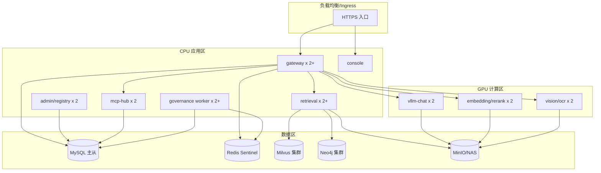

# 09 部署与运维

## 1. 环境规划

| 环境 | 用途 | 数据 | 访问 |
|---|---|---|---|
| `dev` | 本地/联调开发 | 脱敏样本、Mock 数据 | 开发网 |
| `test` | 集成测试、契约测试 | 脱敏样本 | 测试网 |
| `staging` | 预发、压测、灰度验证 | 脱敏或仿真数据 | 受限访问 |
| `prod` | 生产 | 真实业务数据（按密级） | 法院/公司内网 |
| `dr` | 灾备（可选） | 备份/副本 | 隔离网络 |

要求：

- 环境之间网络隔离，禁止开发环境直连生产数据库。
- 每个环境独立的 MySQL、Redis、Milvus、Neo4j、对象存储和密钥。
- 生产变更必须走变更单和审批，禁止手工修改配置。
- 所有环境使用相同的镜像和部署模板，差异通过配置注入。

## 2. 部署拓扑



## 3. 开发环境：Docker Compose

> 以下为开发/联调基线，不包含生产级高可用配置。GPU 服务使用 `gpu` profile 启动。

```yaml
version: "3.9"

x-app-env: &app-env
  APP_ENV: dev
  MYSQL_HOST: mysql
  MYSQL_PORT: "3306"
  MYSQL_DATABASE: ai_platform
  MYSQL_USER: ai
  MYSQL_PASSWORD: ai_dev_password
  REDIS_URL: redis://redis:6379/0
  MILVUS_URI: http://milvus:19530
  NEO4J_URI: bolt://neo4j:7687
  NEO4J_USER: neo4j
  NEO4J_PASSWORD: neo4j_dev_password
  OBJECT_STORAGE_ENDPOINT: http://minio:9000
  OBJECT_STORAGE_ACCESS_KEY: minioadmin
  OBJECT_STORAGE_SECRET_KEY: minioadmin

services:
  mysql:
    image: mysql:8.4
    command:
      - --character-set-server=utf8mb4
      - --collation-server=utf8mb4_0900_ai_ci
    environment:
      MYSQL_ROOT_PASSWORD: root_dev_password
      MYSQL_DATABASE: ai_platform
      MYSQL_USER: ai
      MYSQL_PASSWORD: ai_dev_password
    ports:
      - "3306:3306"
    volumes:
      - mysql_data:/var/lib/mysql
    healthcheck:
      test: ["CMD", "mysqladmin", "ping", "-h", "localhost"]
      interval: 10s
      timeout: 5s
      retries: 10

  redis:
    image: redis:7.4-alpine
    command: ["redis-server", "--appendonly", "yes"]
    ports:
      - "6379:6379"
    volumes:
      - redis_data:/data
    healthcheck:
      test: ["CMD", "redis-cli", "ping"]
      interval: 10s
      timeout: 3s
      retries: 10

  etcd:
    image: quay.io/coreos/etcd:v3.5.16
    environment:
      ETCD_AUTO_COMPACTION_MODE: revision
      ETCD_AUTO_COMPACTION_RETENTION: "1000"
      ETCD_QUOTA_BACKEND_BYTES: "4294967296"
      ETCD_SNAPSHOT_COUNT: "50000"
    command:
      - etcd
      - -advertise-client-urls=http://etcd:2379
      - -listen-client-urls=http://0.0.0.0:2379
      - --data-dir=/etcd
    volumes:
      - etcd_data:/etcd

  minio:
    image: minio/minio:latest
    command: server /data --console-address ":9001"
    environment:
      MINIO_ROOT_USER: minioadmin
      MINIO_ROOT_PASSWORD: minioadmin
    ports:
      - "9000:9000"
      - "9001:9001"
    volumes:
      - minio_data:/data

  milvus:
    image: milvusdb/milvus:v2.5.4
    command: ["milvus", "run", "standalone"]
    environment:
      ETCD_ENDPOINTS: etcd:2379
      MINIO_ADDRESS: minio:9000
    ports:
      - "19530:19530"
      - "9091:9091"
    volumes:
      - milvus_data:/var/lib/milvus
    depends_on:
      - etcd
      - minio

  neo4j:
    image: neo4j:5.26-community
    environment:
      NEO4J_AUTH: neo4j/neo4j_dev_password
      NEO4J_server_memory_heap_max__size: 2G
      NEO4J_server_memory_pagecache_size: 2G
    ports:
      - "7474:7474"
      - "7687:7687"
    volumes:
      - neo4j_data:/data

  gateway:
    build: ./services/gateway
    environment: *app-env
    ports:
      - "8080:8080"
    depends_on:
      mysql:
        condition: service_healthy
      redis:
        condition: service_healthy

  admin:
    build: ./services/admin
    environment: *app-env
    ports:
      - "8081:8081"
    depends_on:
      mysql:
        condition: service_healthy

  retrieval:
    build: ./services/retrieval
    environment: *app-env
    ports:
      - "8082:8082"
    depends_on:
      - mysql
      - redis
      - milvus
      - neo4j

  mcp-hub:
    build: ./services/mcp-hub
    environment: *app-env
    ports:
      - "8083:8083"
    depends_on:
      mysql:
        condition: service_healthy

  worker:
    build: ./services/governance-worker
    environment: *app-env
    depends_on:
      mysql:
        condition: service_healthy
      redis:
        condition: service_healthy

  vllm:
    image: vllm/vllm-openai:latest
    profiles: ["gpu"]
    command:
      - --model=/models/Qwen3-8B
      - --served-model-name=Qwen3-8B
      - --max-model-len=16384
      - --gpu-memory-utilization=0.90
      - --enable-lora
      - --max-loras=4
      - --max-lora-rank=64
    ports:
      - "8000:8000"
    volumes:
      - ./models:/models:ro
    deploy:
      resources:
        reservations:
          devices:
            - driver: nvidia
              count: 1
              capabilities: [gpu]

volumes:
  mysql_data:
  redis_data:
  etcd_data:
  minio_data:
  milvus_data:
  neo4j_data:
```

启动：

```bash
# 基础服务
docker compose up -d

# 含 GPU 推理服务
docker compose --profile gpu up -d

# 查看日志
docker compose logs -f gateway vllm
```

开发环境要求：

- 首次启动后执行数据库迁移和初始化脚本。
- 创建默认租户、管理员、示例能力。
- 生产密钥不得写入 Compose 文件，使用 `.env` + 密钥管理。
- 本地 GPU 不可用时，可使用 Mock 推理服务或远程开发 GPU。

## 4. 生产环境：Kubernetes

### 4.1 命名空间

| 命名空间 | 内容 |
|---|---|
| `ai-platform` | 网关、管理、检索、MCP Hub、控制台 |
| `ai-inference` | vLLM、Embedding、Rerank、Vision |
| `ai-data` | MySQL、Redis、Milvus、Neo4j、MinIO（如自建） |
| `ai-observability` | Prometheus、Grafana、Loki、Tempo |
| `ai-jobs` | 数据治理、索引、评测任务 |

### 4.2 GPU 节点

- 使用 NVIDIA GPU Operator 管理驱动、Device Plugin、DCGM Exporter。
- GPU 节点打标签和 taint：

```bash
kubectl label node gpu-node-01 accelerator=nvidia-a100-80g
kubectl taint node gpu-node-01 dedicated=ai-inference:NoSchedule
```

- 推理 Pod 配置 tolerations 和 nodeAffinity。
- 模型权重使用 PVC（NAS/对象存储 CSI），只读挂载。
- 独立 GPU 池：交互推理、离线批处理、Embedding/Rerank 分池，避免相互影响。

### 4.3 典型工作负载

| 工作负载 | 副本 | 资源 | 说明 |
|---|---|---|---|
| `gateway` | ≥ 2 | 2C4G | HPA 按 CPU/QPS |
| `admin` | ≥ 2 | 2C4G | 控制面 |
| `retrieval` | ≥ 2 | 4C8G | HPA 按 QPS/延迟 |
| `mcp-hub` | ≥ 2 | 2C4G | 长连接需调优 |
| `worker` | ≥ 2 | 4C8G | 按队列深度扩缩 |
| `vllm-chat` | ≥ 2 | 1 GPU | 固定副本或按队列扩缩 |
| `embedding` | ≥ 2 | 1 GPU | 可与 rerank 混部（评估显存） |
| `vision` | ≥ 1 | 1 GPU/CPU | 按 OCR 负载 |

### 4.4 HPA 与 PDB

```yaml
apiVersion: autoscaling/v2
kind: HorizontalPodAutoscaler
metadata:
  name: gateway
spec:
  scaleTargetRef:
    apiVersion: apps/v1
    kind: Deployment
    name: gateway
  minReplicas: 2
  maxReplicas: 10
  metrics:
    - type: Resource
      resource:
        name: cpu
        target:
          type: Utilization
          averageUtilization: 65
```

建议：

- 网关按 CPU + 自定义 QPS 指标扩缩。
- Worker 按 Redis Stream 积压量扩缩（KEDA 或 Prometheus Adapter）。
- vLLM 副本扩缩需考虑模型加载时间，建议保留最小副本，扩容以队列指标触发。
- 所有在线服务配置 PDB，`minAvailable: 1`。

### 4.5 探针

| 服务 | 探针 | 说明 |
|---|---|---|
| 网关/管理/检索 | `/healthz` | 启动、就绪、存活 |
| vLLM | `/health` | 启动探针需覆盖模型加载 |
| Milvus/Neo4j | 官方健康端点 | 就绪后再接流量 |
| Worker | 心跳/队列消费 | 避免误杀长任务 |

### 4.6 网络策略

- 默认拒绝所有入站，按需放行。
- 只允许 Ingress → 网关/控制台；网关 → 推理/检索/MCP；应用 → 数据区白名单端口。
- 推理节点禁止访问互联网。
- 管理面与业务面分离；运维访问经堡垒机。
- 跨命名空间使用 NetworkPolicy + mTLS。

## 5. 配置与密钥

### 5.1 配置分层

| 层级 | 内容 | 管理方式 |
|---|---|---|
| 镜像内置 | 默认配置、Schema | 代码仓库 |
| ConfigMap | 环境相关非敏感配置 | GitOps |
| Secret | 密码、Token、密钥 | Vault/KMS/Sealed Secrets |
| 动态配置 | 能力路由、限流阈值、检索配置 | 控制面 + 审计 |

要求：

- 配置项必须有类型、默认值、校验和说明。
- 敏感配置不得写入镜像、Git、日志。
- 配置变更支持灰度、回滚和审计。
- 生产配置变更必须走 GitOps/变更单。

### 5.2 密钥管理

- 使用 Vault 或云 KMS 管理数据库密码、API Key、对象存储密钥、模型签名密钥。
- Kubernetes Secret 仅作为挂载载体，启用静态加密。
- 密钥定期轮换，API Key 支持双 Key 过渡。
- 禁止在代码、日志、异常信息中输出密钥。
- 离职/转岗及时回收权限和密钥。

## 6. 可观测性

### 6.1 指标

| 层 | 指标 |
|---|---|
| 网关 | 请求量、错误率、P50/P95/P99、TTFT、Token、限流、熔断 |
| 模型 | GPU 利用率、显存、KV Cache、队列、preemption、吞吐、TTFT |
| 检索 | 召回耗时、Rerank 耗时、结果数、空结果率、降级率 |
| 工具 | 调用量、成功率、超时、P95 |
| 数据 | 事件积压、消费延迟、DLQ、索引构建进度、评测任务 |
| 基础设施 | CPU、内存、磁盘、网络、连接数、慢查询 |
| 业务 | 能力复用率、活跃应用、反馈率、Bad Case 关闭率 |

### 6.2 日志

- 结构化 JSON，统一字段：`timestamp`、`level`、`service`、`request_id`、`trace_id`、`tenant_id`、`app_id`、`message`。
- 敏感字段脱敏；禁止记录完整 Prompt/输出（按租户策略）。
- 日志分级：ERROR/WARN/INFO/DEBUG；生产默认 INFO。
- 集中采集到 Loki/ELK，保留期限按合规要求。
- 审计日志单独存储，不可篡改。

### 6.3 链路追踪

- 使用 OpenTelemetry，覆盖网关 → 推理 → 检索 → 工具 → 数据库。
- 采样率：正常 5%–10%，错误 100%。
- Trace 中不记录敏感原文，只记录 ID、耗时、状态、模型/版本。
- 与 Agent Harness 的 Trace 通过 `trace_id` 关联。

### 6.4 仪表盘

建议至少提供：

1. 平台总览：QPS、错误率、P95、GPU 利用率、活跃租户。
2. 能力视角：按能力/版本/租户的调用量、延迟、错误、Token。
3. 模型视角：TTFT、吞吐、KV Cache、队列、Adapter 状态。
4. 检索视角：召回/Rerank 耗时、命中率、空结果、降级。
5. 数据闭环：事件积压、数据集产出、Bad Case 趋势。
6. 安全审计：越权、限流、异常调用、密钥操作。

### 6.5 告警

| 告警 | 阈值 | 级别 |
|---|---|---|
| 网关 5xx 比例 | > 1% 持续 5 分钟 | P1 |
| 网关 P95 延迟 | > 1s 持续 10 分钟 | P2 |
| vLLM 队列 | > 20 持续 5 分钟 | P2 |
| GPU 显存 | > 95% 持续 5 分钟 | P2 |
| 检索 P95 | > 1s 持续 10 分钟 | P2 |
| 事件积压 | > 10k 或延迟 > 10 分钟 | P2 |
| DLQ 数量 | > 0 | P2 |
| 索引构建失败 | 连续 2 次 | P2 |
| 备份失败 | 任意一次 | P1 |
| 证书过期 | < 30 天 | P2 |
| 审计异常 | 越权/批量导出 | P1 |

告警必须包含：影响范围、最近变更、Runbook 链接、值班人。

## 7. 备份与恢复

| 组件 | 备份方式 | 频率 | 保留 | RPO/RTO |
|---|---|---|---|---|
| MySQL | 全量 + binlog | 每日全量，binlog 实时 | 30 天 | RPO ≤ 5min，RTO ≤ 30min |
| Redis | AOF + RDB | 实时/每日 | 7 天 | RPO ≤ 1min，RTO ≤ 5min |
| Milvus | 对象存储快照 + etcd 备份 | 每日 | 14 天 | RTO ≤ 30min；可由源数据重建 |
| Neo4j | `neo4j-admin dump` | 每日 | 14 天 | RTO ≤ 60min |
| 对象存储 | 版本化 + 跨站复制 | 实时 | 按合规 | RTO ≤ 30min |
| 配置/Skills | Git | 每次变更 | 永久 | 可即时恢复 |
| 密钥 | KMS/Vault 备份 | 每日 | 按合规 | 按平台能力 |

要求：

- 每季度做一次恢复演练，记录实际 RTO/RPO。
- 备份加密，异地存放，访问审计。
- 恢复后校验数据一致性（行数、校验和、索引可用性）。
- Milvus/Neo4j 可从源文档和治理流水线重建，但重建时间需纳入预案。

## 8. 安全与合规

### 8.1 网络安全

- 分区隔离：接入区、应用区、AI 区、数据区、运维区。
- 默认拒绝入站；仅放行必要端口。
- Ingress 启用 TLS 1.2+、WAF、限流、IP 白名单（按需）。
- 服务间 mTLS（Service Mesh 或应用层证书）。
- 禁止推理节点访问公网。

### 8.2 身份与权限

- 对接统一身份认证（OIDC/OAuth2/LDAP）。
- RBAC + ABAC：租户、应用、能力、知识库、工具、数据范围。
- 最小权限；定期权限复核。
- 高危操作（发布、删除、导出、生产工具调用）二次确认。
- 服务账号独立，禁止共享账号。

### 8.3 数据安全

- 分级分类：公开、内部、敏感、机密。
- 传输 TLS；静态加密（磁盘/数据库/对象存储）。
- 敏感字段脱敏、掩码、加密；训练数据去标识化。
- 数据最小化留存，到期删除。
- 导出审批、水印、审计。
- 跨租户严格隔离，敏感租户物理隔离。

### 8.4 模型与供应链安全

- 模型权重来源可验证，校验和/签名。
- 镜像来自可信仓库，启用镜像扫描、SBOM、签名验证。
- 依赖漏洞扫描，高危阻断发布。
- 模型/Adapter 上线需评测与审批。
- Prompt 注入、越权工具调用、输出内容安全有防护和测试。

### 8.5 合规

- 遵循网络安全法、数据安全法、个人信息保护法和法院相关规定。
- 等保等级以安全部门评审为准；按等级落实边界防护、审计、备份、入侵检测。
- 数据处理目的限制、最小必要、告知同意（如涉及个人信息）。
- 保留数据处理记录，配合审计与监管检查。
- 外部供应商/标注服务签署保密协议，禁止数据外带。

## 9. 容量与扩缩容

### 9.1 容量估算

| 资源 | 估算方式 |
|---|---|
| GPU | 峰值 QPS × 平均输出 Token / 单卡吞吐 × 冗余系数 1.3 |
| CPU | 网关按 1k QPS ≈ 4–8 核；检索按 QPS 与 Rerank 并发 |
| 内存 | 检索/图查询按索引与缓存规模；JVM/Python 堆按压测 |
| MySQL | 日志表按日增量 × 保留天数；分区归档 |
| Redis | 限流/幂等/缓存按活跃租户与 TTL 估算 |
| Milvus | 向量数 × 维度 × 4 字节 × 副本系数 + 索引开销 |
| Neo4j | 节点/边数 × 属性大小 + 页缓存 |
| 对象存储 | 原始文档 + 解析结果 + 数据集导出 |

### 9.2 扩缩容策略

- 网关/检索：HPA 按 CPU + 自定义 QPS/延迟。
- Worker：按 Stream 积压量扩缩。
- vLLM：保留最小副本；按队列长度和 GPU 利用率扩容；缩容前等待在途请求完成。
- Milvus：按 collection/partition 扩容 query node；索引节点独立。
- Neo4j：读副本扩展读流量；写入主节点。
- MySQL：读写分离；日志表归档；必要时分库分表。

## 10. 发布与回滚

### 10.1 发布流程

1. 代码合并 → CI 构建镜像 → 扫描/SBOM → 推送镜像仓库。
2. 部署到 `test` → 契约测试/集成测试。
3. 部署到 `staging` → 回归/压测/效果评测。
4. 生产灰度（5% → 20% → 50% → 100%）。
5. 观察指标、日志、反馈。
6. 全量或回滚。

### 10.2 数据库迁移

- 采用 Expand-Contract：
  1. 新增字段/表（兼容旧代码）。
  2. 双写/回填。
  3. 切换读路径。
  4. 删除旧字段（至少一个发布周期后）。
- 迁移脚本必须可回滚或有补偿方案。
- 大表变更使用在线 DDL 工具，避免锁表。
- 生产迁移前在 staging 演练。

### 10.3 回滚

- 应用镜像保留最近 5 个版本，支持一键回滚。
- 能力/Adapter/检索配置通过别名切换回滚。
- 数据库迁移回滚需谨慎；优先向前修复。
- 回滚后必须验证核心链路和指标。

## 11. 故障预案

### 11.1 模型服务不可用

- **检测**：健康检查失败、5xx 升高、队列堆积。
- **处置**：摘除故障副本；切换备用能力/模型；限制非关键流量；扩容。
- **恢复**：重启/重建 Pod；检查 GPU、显存、模型加载；必要时回滚版本。
- **验证**：TTFT、错误率、队列恢复正常。

### 11.2 Redis 故障

- **影响**：限流、缓存、幂等、事件流。
- **处置**：切换 Sentinel/Cluster 主节点；启用本地限流兜底；暂停非关键写操作。
- **恢复**：恢复 AOF/RDB；检查数据一致性；重放事件。
- **注意**：幂等记录丢失可能导致重复写，需业务侧配合检查。

### 11.3 MySQL 故障

- **处置**：主从切换；只读降级；暂停管理面写操作。
- **恢复**：恢复主库/提升从库；校验数据；重新连接。
- **注意**：控制面不可用时，网关使用本地缓存继续服务。

### 11.4 Milvus 故障

- **处置**：检索降级为关键词/图谱或返回缓存；暂停索引构建。
- **恢复**：检查 etcd/MinIO/query node；必要时从源文档重建索引。
- **验证**：召回数量、延迟、引用完整性。

### 11.5 Neo4j 故障

- **处置**：关闭图谱召回，降级为向量检索；标记 `graph_degraded=true`。
- **恢复**：重启/切换副本；检查页缓存和磁盘。
- **验证**：图谱查询延迟与结果数。

### 11.6 网关 5xx 激增

- **排查**：上游健康、限流、证书、配置变更、DNS。
- **处置**：回滚最近变更；摘除异常上游；扩容；启用降级。
- **验证**：错误率、P95、调用量恢复。

### 11.7 GPU OOM

- **处置**：降低 `max_num_seqs`/`max_model_len`；减少常驻 LoRA；扩容/迁移。
- **恢复**：重启副本；观察显存曲线；调整参数。
- **预防**：压测、显存告警、限制单请求输出长度。

### 11.8 数据流水线积压

- **排查**：消费者健康、下游数据库、事件突增、毒消息。
- **处置**：扩容 Worker；跳过/隔离毒消息；限流生产端。
- **恢复**：清理积压；重放 DLQ；校验数据完整性。

### 11.9 安全事件

- **处置**：立即隔离受影响服务/账号；保留现场；通知安全团队；按预案取证。
- **恢复**：轮换密钥；修复漏洞；加强监控；复盘。
- **上报**：按公司安全和监管要求及时上报。

## 12. 运维检查清单

### 每日

- [ ] 核心服务可用性与错误率。
- [ ] GPU 利用率、显存、队列。
- [ ] 事件积压、DLQ、索引/评测任务。
- [ ] 备份任务结果。
- [ ] 安全告警与异常调用。

### 每周

- [ ] 容量趋势与扩容评估。
- [ ] 慢查询与索引优化。
- [ ] 日志/磁盘使用率。
- [ ] 证书与密钥有效期。
- [ ] Bad Case 与反馈趋势。

### 每月

- [ ] 权限复核。
- [ ] 依赖漏洞与镜像扫描。
- [ ] 恢复演练（抽样）。
- [ ] 模型/检索效果回归。
- [ ] 容量与成本复盘。

### 每季度

- [ ] 全链路灾备演练。
- [ ] 安全渗透测试（按需）。
- [ ] 架构与容量评审。
- [ ] 运维手册与预案更新。

## 13. 验收标准

1. Docker Compose 可一键启动开发环境，核心服务健康。
2. Kubernetes 生产模板可部署，GPU 调度、探针、PDB、HPA 生效。
3. 配置与密钥分离，生产无明文密钥。
4. 指标、日志、Trace 覆盖网关、推理、检索、工具和数据流水线。
5. 关键告警可触发并包含 Runbook。
6. 备份可恢复，季度演练达到 RTO/RPO 目标。
7. 网络分区、权限、加密、审计满足安全评审要求。
8. 发布与回滚流程可执行，灰度期间指标可对比。
9. 故障预案覆盖模型、Redis、MySQL、Milvus、Neo4j、GPU、流水线和安全事件。
10. 运维检查清单纳入日常值班。
