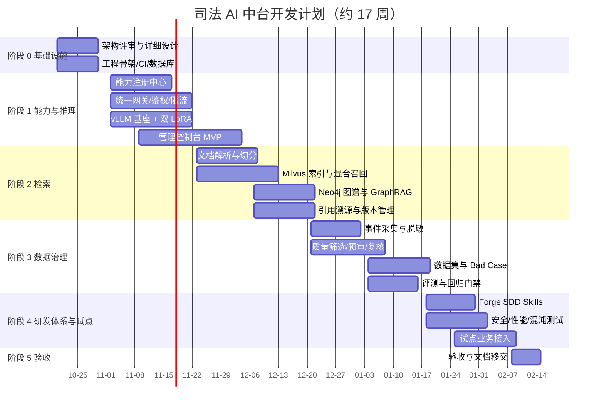

# 10 开发计划与验收

## 1. 项目组织

### 1.1 建议团队

| 角色 | 人数 | 职责 |
|---|---|---|
| 架构师/项目负责人 | 1 | 总体架构、技术决策、跨团队协调、评审 |
| 后端工程师（网关/注册/MCP） | 2 | 能力注册、网关、授权、限流、MCP Hub |
| AI 工程师（推理/算法） | 1 | vLLM、LoRA、Embedding/Rerank、模型评测 |
| 数据工程师（检索） | 1 | 文档解析、Milvus、Neo4j、混合召回、引用 |
| 平台工程师（治理） | 1 | 数据闭环、标注/数据集、评测流水线 |
| 前端工程师 | 1 | 管理控制台 |
| 测试工程师 | 0.5–1 | 测试策略、自动化、验收 |
| DevOps/安全 | 0.5–1 | 部署、CI/CD、监控、安全合规 |

> 可按团队实际情况合并角色，但网关、推理、检索、数据治理四个方向必须有明确负责人。

### 1.2 沟通机制

- 每日站会 15 分钟，同步进度与阻塞。
- 每周架构/风险评审一次。
- 每两周 Demo 一次，演示可运行增量。
- 关键设计（ADR）必须书面评审。
- 安全、合规、数据问题随时升级。

## 2. 里程碑（约 17 周基线）

> 日期为示意，以项目启动日为准。阶段之间允许适度并行，但阶段 1 的网关与注册中心必须先于检索和治理接入。

### 2.1 阶段目标与退出条件

| 阶段 | 目标 | 退出条件 |
|---|---|---|
| 0 基础设施 | 工程骨架、CI、数据库、部署环境就绪 | 代码可构建、迁移可执行、开发环境可启动 |
| 1 能力与推理 | 能力注册、网关、鉴权、限流、Qwen3 + 双 LoRA 可用 | 业务应用可通过能力编码调用模型；压测达标 |
| 2 检索 | 文档接入、混合召回、图谱、引用、版本管理可用 | 检索 API 可用；评测集 Recall@10 达标 |
| 3 数据治理 | 事件采集、脱敏、筛选、复核、数据集、Bad Case 闭环 | 可从反馈生成数据集版本；Bad Case 可追踪 |
| 4 研发体系与试点 | Forge SDD 落地；安全/性能测试；试点接入 | 试点业务端到端可用；无 P0/P1 问题 |
| 5 验收 | 验收、文档、移交 | 验收项全部通过；运维可独立接管 |

## 3. WBS 工作分解

### 3.1 阶段 0：基础设施（第 1–2 周）

| 编号 | 任务 | 负责 | 产出 |
|---|---|---|---|
| 0.1 | 架构与详细设计评审 | 架构师 | 设计文档定稿、ADR |
| 0.2 | 仓库与模块初始化 | 后端 | 目录结构、构建脚本 |
| 0.3 | CI/CD 流水线 | DevOps | lint/test/build/scan |
| 0.4 | MySQL 表结构与迁移 | 后端 | DDL、Alembic/Flyway |
| 0.5 | Redis/Milvus/Neo4j 开发环境 | DevOps | Docker Compose |
| 0.6 | 统一认证/租户模型 | 后端 | 认证、租户、应用 |
| 0.7 | 日志/异常/配置规范 | 后端 | 公共库、示例 |
| 0.8 | OpenAPI 规范与 SDK 骨架 | 后端 | OpenAPI、Python/Java SDK |

### 3.2 阶段 1：能力与推理（第 3–6 周）

| 编号 | 任务 | 负责 | 产出 |
|---|---|---|---|
| 1.1 | 能力元数据与状态机 | 后端 | 注册中心 |
| 1.2 | 能力版本发布/回滚 | 后端 | 版本 API |
| 1.3 | 应用授权与配额 | 后端 | 授权、限流 |
| 1.4 | 统一网关与 SSE | 后端 | 网关 |
| 1.5 | OpenAI 兼容接口 | 后端 | chat/embeddings |
| 1.6 | vLLM 部署与参数调优 | AI | Qwen3-8B 服务 |
| 1.7 | LoRA 注册/加载/回滚 | AI | Adapter 流水线 |
| 1.8 | 混合负载压测 | AI/测试 | 压测报告 |
| 1.9 | 管理控制台 MVP | 前端 | 能力/应用/配额页面 |
| 1.10 | 调用日志与计量 | 后端 | usage_record、事件 |

### 3.3 阶段 2：检索（第 7–10 周）

| 编号 | 任务 | 负责 | 产出 |
|---|---|---|---|
| 2.1 | 知识库与文档模型 | 数据 | KB/document API |
| 2.2 | PDF/DOCX/HTML 解析 | 数据 | 解析流水线 |
| 2.3 | OCR/版面/表格 | 数据 | 视觉解析 |
| 2.4 | 结构感知切分与元数据 | 数据 | Chunk 流水线 |
| 2.5 | Milvus collection/index | 数据 | 向量索引 |
| 2.6 | 混合召回与融合 | 数据 | retrieve API |
| 2.7 | Rerank 集成 | 数据/AI | 精排 |
| 2.8 | Neo4j 本体与导入 | 数据 | 图谱 |
| 2.9 | GraphRAG 召回 | 数据 | 图谱检索 |
| 2.10 | 引用溯源 | 数据 | citations |
| 2.11 | 版本/别名/回滚 | 数据 | 版本管理 |
| 2.12 | 检索评测集与指标 | 数据/测试 | 评测报告 |

### 3.4 阶段 3：数据治理（第 11–13 周）

| 编号 | 任务 | 负责 | 产出 |
|---|---|---|---|
| 3.1 | 事件采集与 Stream | 平台 | ai_event |
| 3.2 | 脱敏/清洗/去重 | 平台 | 治理流水线 |
| 3.3 | 质量筛选 | 平台 | 质量分与规则 |
| 3.4 | 模型预审 | AI/平台 | 预标注/评审 |
| 3.5 | 人工复核与标注 | 平台 | 标注任务 |
| 3.6 | 数据集版本与血缘 | 平台 | dataset_version |
| 3.7 | Bad Case 管理 | 平台 | bad_case 流程 |
| 3.8 | 评测与回归门禁 | 平台/AI | eval_task |
| 3.9 | 数据合规与保留 | 安全/平台 | 保留/删除策略 |

### 3.5 阶段 4：研发体系与试点（第 14–16 周）

| 编号 | 任务 | 负责 | 产出 |
|---|---|---|---|
| 4.1 | Forge SDD Skills | 架构/研发效能 | Skills 包 |
| 4.2 | MCP 只读集成 | 后端 | Git/文档/需求 |
| 4.3 | 自动化门禁 | DevOps | CI 门禁 |
| 4.4 | 安全测试 | 安全/测试 | 安全报告 |
| 4.5 | 性能/混沌测试 | 测试/DevOps | 测试报告 |
| 4.6 | 试点业务接入 | 全员 | 端到端场景 |
| 4.7 | 运维手册/值班 | DevOps | Runbook |

### 3.6 阶段 5：验收（第 17 周）

| 编号 | 任务 | 负责 | 产出 |
|---|---|---|---|
| 5.1 | 功能验收 | 测试/业务 | 验收记录 |
| 5.2 | 性能验收 | 测试 | 压测报告 |
| 5.3 | 效果验收 | AI/数据 | 评测报告 |
| 5.4 | 安全合规验收 | 安全 | 安全报告 |
| 5.5 | 文档与培训 | 全员 | 文档、培训 |
| 5.6 | 移交与复盘 | 负责人 | 移交清单 |

## 4. 依赖与前置条件

| 依赖 | 需要时间 | 负责方 | 风险 |
|---|---|---|---|
| GPU 资源（≥ 2× 48GB） | 第 1 周前 | 基础设施 | 高 |
| 法院/公司内网部署审批 | 第 1 周前 | 安全/合规 | 高 |
| 统一身份认证对接 | 第 2 周前 | IAM 团队 | 中 |
| 试点业务需求与数据 | 第 4 周前 | 业务方 | 高 |
| 评测集与领域专家 | 第 6 周前 | 业务/算法 | 高 |
| 模型/LoRA 合规审批 | 第 6 周前 | 合规 | 高 |
| Milvus/Neo4j 生产集群 | 第 8 周前 | 基础设施 | 中 |
| Claude Code 企业版/网络策略 | 第 12 周前 | IT/安全 | 中 |
| MCP 工具/业务 API 开放 | 第 12 周前 | 业务系统 | 中 |

## 5. 测试策略

### 5.1 测试层级

| 层级 | 内容 | 工具 | 责任 |
|---|---|---|---|
| 单元测试 | 领域逻辑、校验、路由、限流 | pytest | 开发 |
| 集成测试 | MySQL/Redis/Milvus/Neo4j | Testcontainers | 开发/测试 |
| 契约测试 | OpenAPI、SDK、MCP | Schemathesis/Pact | 后端/测试 |
| 端到端测试 | 注册→调用→检索→反馈 | pytest/Playwright | 测试 |
| 性能测试 | 网关、推理、检索、并发 | Locust/k6 | 测试/AI |
| 安全测试 | 认证、越权、注入、泄漏 | SAST/DAST/手工 | 安全 |
| 模型评测 | 分类、抽取、生成、安全 | 自研评测 | AI |
| RAG 评测 | 召回、排序、引用 | 自研评测 | 数据 |
| 混沌测试 | 依赖故障、超时、断流 | Chaos Mesh | DevOps |
| UAT | 试点业务流程 | 手工 | 业务 |

### 5.2 覆盖率要求

- 核心模块（网关、授权、限流、能力注册、数据治理）行覆盖率 ≥ 80%。
- 其他模块 ≥ 70%。
- 关键分支和异常路径必须有测试。
- 新增接口必须有契约测试和至少一个集成测试。

### 5.3 测试数据

- 使用脱敏/合成数据，禁止真实敏感案件数据进入测试环境。
- 评测集由业务专家确认，版本化管理。
- 性能测试数据按真实长度分布构造。
- 安全测试包含 Prompt 注入、越权、敏感信息、工具滥用场景。

### 5.4 缺陷等级

| 等级 | 定义 | 处理 |
|---|---|---|
| P0 | 数据泄漏、越权、服务不可用 | 立即修复，阻断发布 |
| P1 | 核心功能失败、严重性能问题 | 发布前修复 |
| P2 | 非核心功能问题、体验问题 | 可排期修复 |
| P3 | 文案/样式/建议 | 后续迭代 |

## 6. 验收标准

### 6.1 功能验收

| 编号 | 验收项 | 通过标准 |
|---|---|---|
| F1 | 能力注册 | 注册、版本、发布、灰度、回滚、下线全流程可用 |
| F2 | 统一网关 | 认证、鉴权、限流、路由、SSE、错误映射可用 |
| F3 | 模型推理 | Qwen3-8B + ≥ 2 个 LoRA 可调用；Adapter 动态加载/回滚 |
| F4 | 公共检索 | 文档接入、混合召回、Rerank、引用、图谱可用 |
| F5 | 版本管理 | KB/索引/检索配置独立版本，别名切换与回滚可用 |
| F6 | MCP 工具 | 注册、发现、鉴权、调用、审计可用 |
| F7 | 数据治理 | 采集、脱敏、筛选、预审、复核、数据集、Bad Case 闭环可用 |
| F8 | 管理控制台 | 能力、应用、知识库、数据集、配额、审计可管理 |
| F9 | 权限与审计 | 租户/应用/能力/数据权限正确，关键操作可审计 |
| F10 | Forge SDD | Skills、MCP、门禁、产物模板可运行 |

### 6.2 非功能验收

| 编号 | 指标 | 目标 |
|---|---|---|
| N1 | 网关可用性 | ≥ 99.9%（控制面）/ 99.5%（在线） |
| N2 | 网关附加延迟 | P95 ≤ 30ms |
| N3 | Chat TTFT | P95 ≤ 2s（1K 输入，基线 GPU） |
| N4 | Chat 吞吐 | 集群 ≥ 15 req/s（2 副本，1K/256） |
| N5 | 检索延迟 | P95 ≤ 500ms（Top-50 + Rerank） |
| N6 | 工具调用开销 | P95 ≤ 20ms（不含业务系统） |
| N7 | 并发能力 | 支持 200 并发在线请求（按压测配置） |
| N8 | 稳定性 | 8 小时连续压测无 OOM、错误率 < 0.5% |
| N9 | 恢复能力 | MySQL RTO ≤ 30min，Redis RTO ≤ 5min |
| N10 | 安全 | 无 P0/P1 安全漏洞；越权测试全部通过 |

### 6.3 效果验收

| 编号 | 指标 | 目标（以双方确认评测集为准） |
|---|---|---|
| Q1 | 检索 Recall@10 | ≥ 0.90 |
| Q2 | 引用准确率 | ≥ 0.95 |
| Q3 | 分类/抽取 | 达到业务设定基线，较原方案不劣化 |
| Q4 | 生成质量 | 人工评分/Win Rate 达到约定目标 |
| Q5 | 幻觉率 | 不高于基线，关键场景有引用支撑 |
| Q6 | 安全 | 高危内容、越权回答、敏感信息泄漏为 0 |

### 6.4 交付验收

- 代码、镜像、部署包、数据库脚本齐全。
- OpenAPI、SDK、MCP 规范、运维手册齐全。
- 测试报告、压测报告、评测报告、安全报告齐全。
- 试点业务完成 UAT 并签字。
- 运维团队完成接管演练。
- 培训完成，值班表明确。

## 7. 风险与对策

| 风险 | 概率 | 影响 | 对策 |
|---|---|---|---|
| GPU 资源不足/到货延迟 | 高 | 高 | 提前锁定资源；开发期用量化/共享；准备 CPU 降级方案 |
| 真实数据获取与脱敏周期长 | 高 | 高 | 先用合成/脱敏样本；建立数据绿色通道；法务提前介入 |
| 检索效果不达标 | 中 | 高 | 早建评测集；解析/切分/Embedding/Rerank 分阶段调优；保留人工兜底 |
| LoRA 任务干扰 | 中 | 中 | 限制常驻 Adapter；严格路由；逐任务回归；必要时独立副本 |
| 安全审批延迟 | 高 | 高 | 安全设计前置；等保/密评同步；准备离线部署包 |
| 业务系统接入复杂 | 中 | 中 | 提供 SDK/OpenAPI/MCP 三种方式；先做 1 个试点；接口契约先行 |
| 需求蔓延 | 高 | 中 | 明确 v1 范围；变更走评审；非目标写入 Spec |
| 长上下文性能不达标 | 中 | 中 | 限制 max_model_len；长文本单独路由；分块摘要 |
| Milvus/Neo4j 运维复杂 | 中 | 中 | 使用成熟发行版；托管/专家支持；备份与重建预案 |
| 模型许可/合规问题 | 中 | 高 | 提前法务评审；只使用合规模型；记录来源与授权 |
| 团队技能不足 | 中 | 中 | 培训；外部专家；先做技术 spike |
| 数据闭环无人使用 | 中 | 中 | 把反馈嵌入业务流程；指标考核；Bad Case 例会 |

## 8. 交付物清单

| 类别 | 交付物 |
|---|---|
| 设计 | 本套开发文档、ADR、OpenAPI 契约、数据字典 |
| 代码 | 网关、注册中心、推理服务、检索服务、MCP Hub、数据治理、控制台 |
| SDK | Python SDK、Java SDK/Spring Boot Starter |
| 部署 | Docker Compose、Helm Chart/K8s manifests、初始化脚本 |
| 测试 | 单元/集成/契约/E2E/性能/安全/效果报告 |
| 运维 | 部署手册、运维手册、Runbook、监控大盘、告警规则 |
| 研发体系 | Forge SDD Skills 包、MCP 配置、门禁脚本 |
| 培训 | 架构培训、接入培训、运维培训、演示环境 |
| 验收 | 验收报告、UAT 签字、移交清单 |

## 9. 上线检查清单

### 上线前

- [ ] 验收项全部通过，无 P0/P1 缺陷。
- [ ] 安全评审通过，渗透/越权测试完成。
- [ ] 性能压测达标，容量满足首年预估。
- [ ] 数据迁移/初始化完成，校验通过。
- [ ] 监控、告警、日志、Trace 就绪。
- [ ] 备份与恢复演练完成。
- [ ] 回滚方案与责任人明确。
- [ ] 试点业务完成 UAT。
- [ ] 运维值班与升级路径明确。
- [ ] 用户/接入方培训完成。

### 上线时

- [ ] 按灰度计划放量 5% → 20% → 50% → 100%。
- [ ] 每阶段观察错误率、延迟、GPU、检索、反馈。
- [ ] 异常时立即回滚并保留现场。
- [ ] 记录变更单与操作日志。

### 上线后

- [ ] 24 小时重点保障。
- [ ] 每日复盘指标与问题。
- [ ] 一周内完成首轮效果评估。
- [ ] 将线上 Bad Case 纳入回归集。
- [ ] 更新容量与告警阈值。

## 10. 项目成功判定

项目成功需要同时满足：

1. 平台功能完整，通过验收。
2. 至少 2 条业务线/Agent 实际接入并稳定运行。
3. 模型、检索、工具能力实现复用，接入周期明显缩短。
4. 数据闭环产生可用的训练/评测/Bad Case 资产。
5. 安全、合规、运维体系可独立运转。
6. 形成可复制的 Forge SDD 研发规范。
